# 04. DB 設計書（Phase 1）

PostgreSQL（Supabase）。全テナントデータに `organization_id` を持たせ、RLS で分離する（05 参照）。

## 1. 共通方針

- 主キー：`uuid`（`gen_random_uuid()`）。推測可能な連番 ID を URL に出さない
- 全テーブル：`created_at timestamptz default now()`、更新系は `updated_at`（トリガーで更新）
- テナント表：`organization_id uuid not null`。店舗単位の表は `store_id` も持つ
- 子テーブルは **`(organization_id, id)` の複合外部キー**で親を参照し、別組織の行への紐付けを DB レベルで不可能にする
- 顧客等は論理削除（`deleted_at`）。個人情報削除依頼時は匿名化（07 のデータ削除参照）
- 列挙値は `text` ＋ `check` 制約（将来の値追加を容易にするため PostgreSQL enum は使わない）
- 日付の「日」の判定は組織のタイムゾーン（既定 `Asia/Tokyo`）で行う

## 2. ER 図

```mermaid
erDiagram
    organizations ||--o{ stores : has
    organizations ||--o{ memberships : has
    users ||--o{ memberships : has
    stores ||--o{ memberships : "scopes (nullable)"
    users ||--o| platform_admins : "may be"

    organizations ||--o{ customers : owns
    stores ||--o{ customers : "home store"
    users ||--o{ customers : "assigned staff"
    customers ||--o{ customer_tags : has
    tags ||--o{ customer_tags : labels
    organizations ||--o{ tags : owns

    customers ||--o{ visits : has
    customers ||--o{ appointments : has
    customers ||--o{ consent_records : has
    customers ||--o{ customer_notes : has

    organizations ||--o{ followup_rules : defines
    followup_rules ||--o{ followup_tasks : generates
    customers ||--o{ followup_tasks : targets
    users ||--o{ followup_tasks : "assigned to"
    message_templates ||--o{ followup_rules : "default template"

    followup_tasks ||--o{ contact_logs : records
    customers ||--o{ contact_logs : has
    message_templates ||--o{ contact_logs : "used"

    organizations ||--o{ message_templates : owns
    organizations ||--o{ import_jobs : runs
    organizations ||--o{ audit_logs : "logged in"

    customers ||--o{ customer_channel_identities : "Phase2 reserved"
    messaging_channels ||--o{ customer_channel_identities : "Phase2 reserved"

    organizations {
        uuid id PK
        text name
        text slug UK
        text status "active|suspended"
        text timezone
        jsonb settings "consent/visibility prefs"
        jsonb limits "plan limits (future billing)"
    }
    stores {
        uuid id PK
        uuid organization_id FK
        text name
        text code
        text phone
        text address
        boolean is_active
    }
    users {
        uuid id PK "= auth.users.id"
        text display_name
        text email
        boolean is_active
    }
    platform_admins {
        uuid user_id PK
        timestamptz granted_at
    }
    memberships {
        uuid id PK
        uuid user_id FK
        uuid organization_id FK
        uuid store_id FK "null = org-wide"
        text role "org_admin|store_manager|staff"
        text status "invited|active|disabled"
    }
    customers {
        uuid id PK
        uuid organization_id FK
        uuid store_id FK
        text customer_code UK "unique per org"
        text family_name
        text given_name
        text family_name_kana
        text given_name_kana
        text phone
        text email
        uuid assigned_staff_id FK
        text contact_status "unknown|allowed|not_allowed|unsubscribed"
        date first_visit_on "derived"
        date last_visit_on "derived"
        timestamptz deleted_at
        timestamptz anonymized_at
    }
    tags {
        uuid id PK
        uuid organization_id FK
        text name
        text color
    }
    customer_tags {
        uuid customer_id PK
        uuid tag_id PK
        uuid organization_id FK
    }
    customer_notes {
        uuid id PK
        uuid organization_id FK
        uuid customer_id FK
        uuid author_id FK
        text body
    }
    visits {
        uuid id PK
        uuid organization_id FK
        uuid store_id FK
        uuid customer_id FK
        date visited_on
        uuid staff_id FK
        text menu_label "free text, non-medical"
        text source "manual|csv"
    }
    appointments {
        uuid id PK
        uuid organization_id FK
        uuid store_id FK
        uuid customer_id FK
        timestamptz scheduled_at
        text status "scheduled|confirmed|cancelled|completed|no_show"
        text source "manual|csv|staff_reported"
        text external_ref
    }
    followup_rules {
        uuid id PK
        uuid organization_id FK
        uuid store_id FK "null = all stores"
        text name
        text rule_type
        int offset_days
        int due_in_days
        int max_lookback_days
        text task_kind "contact|internal"
        text priority "high|normal|low"
        text assignee_strategy
        uuid default_template_id FK
        boolean is_active
    }
    followup_tasks {
        uuid id PK
        uuid organization_id FK
        uuid store_id FK
        uuid customer_id FK
        uuid rule_id FK "null = manual"
        text period_key "dedupe key"
        text task_kind
        text status "open|done|on_hold|not_applicable"
        text priority
        date due_on
        uuid assigned_to FK
        text close_reason
        timestamptz completed_at
        uuid completed_by FK
    }
    message_templates {
        uuid id PK
        uuid organization_id FK
        uuid store_id FK "null = org-wide"
        text category
        text name
        text body
        boolean is_archived
        int version
    }
    contact_logs {
        uuid id PK
        uuid organization_id FK
        uuid store_id FK
        uuid customer_id FK
        uuid task_id FK
        uuid template_id FK
        text channel
        text outcome
        text content
        timestamptz contacted_at
        uuid staff_id FK
    }
    consent_records {
        uuid id PK
        uuid organization_id FK
        uuid customer_id FK
        text channel "all|phone|line|email|sms"
        text status "granted|not_allowed|unsubscribed"
        text source
        text note
        uuid recorded_by FK
        timestamptz recorded_at
    }
    import_jobs {
        uuid id PK
        uuid organization_id FK
        uuid store_id FK
        text kind "customers|visits|appointments"
        text status
        int total_rows
        int error_rows
        jsonb errors
    }
    audit_logs {
        bigint id PK
        uuid organization_id FK "null = platform"
        uuid actor_user_id FK
        text action
        text entity_type
        uuid entity_id
        jsonb changes "PII masked"
        inet ip
        timestamptz created_at
    }
    messaging_channels {
        uuid id PK
        uuid organization_id FK
        uuid store_id FK
        text provider "line (Phase2)"
    }
    customer_channel_identities {
        uuid id PK
        uuid organization_id FK
        uuid customer_id FK
        uuid channel_id FK
        text provider
        text external_user_id_hash
    }
```

## 3. テーブル定義（主要列・制約）

### organizations
| 列 | 型 | 制約・説明 |
|---|---|---|
| id | uuid | PK |
| name | text | not null |
| slug | text | unique、URL 用（`^[a-z0-9-]{3,40}$`） |
| status | text | `active` / `suspended`（停止中は全業務 API を拒否） |
| timezone | text | 既定 `Asia/Tokyo` |
| settings | jsonb | `{ include_unknown_consent: false, staff_visibility: "store" \| "assigned" }` |
| limits | jsonb | `{ max_stores, max_staff, max_customers }`（将来の課金用） |

### stores
`organization_id` + `code` で unique。`unique (organization_id, id)`（複合FK参照用）。

### users
`auth.users` と 1:1。パスワードは Supabase Auth が管理し、本テーブルには保持しない。
`auth.users` 作成時トリガーで行を作成。

### platform_admins
Platform Admin を **memberships とは別表**で管理。RLS 上どの組織の顧客データにも一致しないため、
既定で顧客情報にアクセスできない。付与・剥奪は SQL（マイグレーション／サービスロール）のみ。

### memberships
| 列 | 説明 |
|---|---|
| role | `org_admin`（store_id は null 必須）/ `store_manager`・`staff`（store_id 必須） |
| 制約 | `unique (user_id, organization_id, store_id)`、`check` でロールと store_id の整合 |

複数店舗所属は店舗ごとに行を持つ。

### customers
| 列 | 説明 |
|---|---|
| customer_code | `unique (organization_id, customer_code)` |
| 氏名・かな | 検索用に `pg_trgm` の GIN インデックス（氏名・かな・電話） |
| contact_status | `consent_records` 挿入時トリガーで最新状態に更新（スナップショット） |
| first_visit_on / last_visit_on | `visits` の変更トリガーで再計算 |
| deleted_at / anonymized_at | 論理削除・匿名化 |

**含めない項目**：症状・傷病名・既往歴・施術詳細などの医療情報、生年月日の完全な値（必要になった場合も年月まで）。

インデックス：`(organization_id, store_id, last_visit_on)`、`(organization_id, assigned_staff_id)`。

### visits / appointments
- `visits`：`(organization_id, customer_id, visited_on)`。同一顧客・同日の重複は CSV 取込で警告
- `appointments`：今後の予約（`scheduled_at > now()` かつ `status in (scheduled, confirmed)`）を「次回予約」とする
- 予約レコードが無い場合 UI は **「予約未確認」**（予約が無いとは断定しない）

### followup_rules
| 列 | 説明 |
|---|---|
| rule_type | `days_since_first_visit` / `days_since_last_visit` / `no_confirmed_next_appointment` / `days_since_last_followup` |
| offset_days | 起点から何日経過で対象にするか（1〜730） |
| due_in_days | 生成日から何日以内に対応するか（0〜30） |
| max_lookback_days | 起点がこれより古い場合は生成しない（CSV 取込直後の大量生成を防ぐ。既定 30） |
| task_kind | `contact`（連絡を伴う：連絡不可は除外）/ `internal`（予約状況の確認など社内作業） |
| assignee_strategy | `customer_staff` → `store_manager` → `unassigned` の順でフォールバック |

### followup_tasks
| 列 | 説明 |
|---|---|
| period_key | 起点イベントを表す決定的なキー（06 参照） |
| status | `open`（未対応）/ `done`（対応済み）/ `on_hold`（保留）/ `not_applicable`（対象外） |
| close_reason | 対象外の理由：`manual` / `condition_resolved` / `contact_not_allowed` / `customer_deleted` |
| **重複防止** | `unique (organization_id, rule_id, customer_id, period_key)`（`rule_id is not null` の部分インデックス） |

インデックス：`(organization_id, status, due_on)`、`(organization_id, assigned_to, status)`。

### message_templates
初期5カテゴリ：`thanks_first_visit` / `condition_check` / `next_appointment` / `lapsed` / `seasonal`（＋`other`）。
編集時は `version` を加算し、`contact_logs.content` に送信時点の文面を保存するため過去記録は変わらない。

### contact_logs
| 列 | 値 |
|---|---|
| channel | `phone` / `line_manual` / `email_manual` / `sms_manual` / `in_person` / `other` |
| outcome | `reached` / `no_answer` / `sent` / `replied` / `appointment_reported` / `declined` / `other` |

`*_manual` は「スタッフが別ツールで送信した」ことを示す。Phase 1 のシステムからは送信しない。

### consent_records
**追記専用**（UPDATE/DELETE 不可）。誰が・いつ・どの経路で同意／停止を記録したかを残す。
挿入トリガーで `customers.contact_status` を更新し、`unsubscribed` / `not_allowed` の場合は
その顧客の未対応の連絡タスクを `not_applicable`（`contact_not_allowed`）にする。

### import_jobs
CSV 取込の結果を保持。`errors` に行番号・列名・理由（値そのものは保存しない）。

### audit_logs
**追記専用**。書き込みは `security definer` 関数 `app.write_audit_log()` 経由のみ。
`changes` には変更された列名と、個人情報以外の値のみを記録（氏名・電話等は `"***"`）。
対象：ログイン、顧客の作成・更新・削除・エクスポート、権限変更、ルール変更、タスク状態変更、CSV 取込、Platform Admin の全操作。

## 4. Phase 2 拡張ポイント（今回はテーブル作成のみ検討、API 実装なし）

| テーブル | 目的 |
|---|---|
| `messaging_channels` | 組織・店舗ごとの LINE 公式アカウント。チャネルシークレット等は **Supabase Vault** に保存し、本表には参照 ID のみ |
| `customer_channel_identities` | 顧客 ⇔ 外部メッセージング ID の紐付け。`unique (channel_id, external_user_id)`。紐付け方法・同意日時・解除日時を保持 |
| `outbound_messages`（Phase 2 で追加） | 送信キュー・送信結果。`followup_tasks` / `contact_logs` と紐付け |

Phase 1 から用意しておくもの：
- `consent_records.channel` / `contact_logs.channel` に `line` 系の値
- `contact_logs` に `external_message_id`（null 許容）列
- テンプレートの差し込み変数の仕組み（LINE 送信時にそのまま利用）

`messaging_channels` / `customer_channel_identities` は **Phase 1 では作成しない**方針を推奨
（未使用テーブルの RLS 設定漏れリスクを避けるため）。Phase 2 のマイグレーションで追加する。
