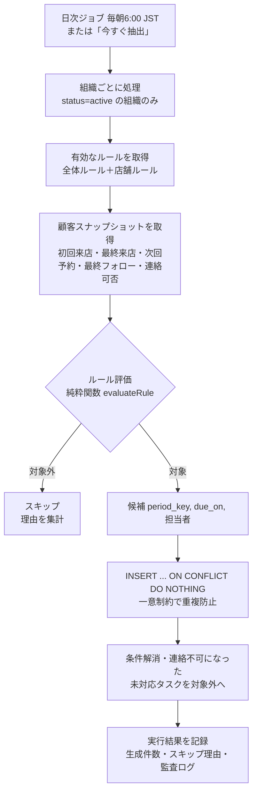

# 06. フォロー抽出ロジック設計

## 1. 全体の流れ



- 評価ロジックは **DB アクセスを持たない TypeScript の純粋関数**（`lib/followup/evaluate.ts`）として実装し、Vitest で網羅的にテストする
- 最終的な重複防止は **DB の一意制約**が担保する（ジョブの二重起動・並行実行でも重複しない）
- 実行は Vercel Cron → Route Handler（`CRON_SECRET` で認証）→ サービスロールで組織ごとに処理
- 「今すぐ抽出」は管理者が自組織（Store Manager は自店舗のルール）のみ実行できる

## 2. 「今日」の定義

組織のタイムゾーン（既定 `Asia/Tokyo`）での日付 `asOf`。日数計算は日付単位（時刻は使わない）。
`daysBetween(a, b)` = 暦日差。

## 3. 顧客スナップショット

| 項目 | 算出 |
|---|---|
| firstVisitOn | `min(visits.visited_on)` |
| lastVisitOn | `max(visits.visited_on)` |
| nextAppointment | `scheduled_at >= asOf` かつ `status in (scheduled, confirmed)` の最も早い予約。無ければ `null`（＝**予約未確認**） |
| lastFollowupOn | 最新の `contact_logs.contacted_at`（outcome が `reached` / `sent` / `replied` / `appointment_reported`）の日付 |
| contactStatus | `unknown` / `allowed` / `not_allowed` / `unsubscribed` |
| isDeleted | `deleted_at` または `anonymized_at` が非 null |

## 4. ルール種別ごとの判定

共通：`offset_days = N`、`max_lookback_days = L`。起点日 `anchor` から `N` 日以上経過し、かつ
`N + L` 日を超えて古くない（＝`N ≤ daysBetween(anchor, asOf) ≤ N + L`）場合に対象。
L は CSV 取込直後に過去分のタスクが大量に生成されるのを防ぐ。

| rule_type | 起点 anchor | 追加条件 | period_key |
|---|---|---|---|
| `days_since_first_visit` | firstVisitOn | なし | `fv:{firstVisitOn}` |
| `days_since_last_visit` | lastVisitOn | なし（N日の間に再来店すれば lastVisitOn が更新され、自然に対象外） | `lv:{lastVisitOn}` |
| `no_confirmed_next_appointment` | lastVisitOn | nextAppointment が null | `na:{lastVisitOn}` |
| `days_since_last_followup` | lastFollowupOn | lastFollowupOn が null の場合は対象外（他ルールで拾う） | `lf:{lastFollowupOn}` |

**period_key は「どの出来事を起点にしたタスクか」**を表す。同じ起点に対しては何度ジョブを実行しても
同じキーになるため、`unique (organization_id, rule_id, customer_id, period_key)` で重複が防止される。
顧客が再来店すれば起点が変わり、次のサイクルのタスクが生成可能になる。

### 「予約未確認」の扱い

- `no_confirmed_next_appointment` のタスク名・画面表示は **「予約未確認」**。「予約なし」とは表示しない
- このルールの既定 `task_kind` は `internal`（予約状況の確認作業）。組織が `contact` に変更した場合は連絡可否の除外が適用される
- スタッフが確認した結果は対応記録の結果で残す：「予約あり（外部で確認）」→ `appointments` に `source=staff_reported` で登録、「予約なしを確認」「不明」

## 5. 除外条件（評価の最初に判定）

| 条件 | contact タスク | internal タスク |
|---|---|---|
| 顧客が削除・匿名化済み | 除外 | 除外 |
| `contactStatus` が `not_allowed` / `unsubscribed` | **除外** | 生成する |
| `contactStatus` が `unknown` | 組織設定 `include_unknown_consent` が false なら除外（既定）＝「同意確認が必要」一覧へ | 生成する |
| ルールが店舗ルールで、顧客の所属店舗が異なる | 除外 | 除外 |
| 起点日が null（来店記録なし等） | 除外 | 除外 |

チャネル別の同意（`line` のみ停止 等）は、Phase 1 では `channel = all` の記録で判定し、
チャネル別の停止は顧客詳細・タスク詳細に警告として表示する（Phase 2 で送信チャネル単位の判定に拡張）。

## 6. 生成後の自動更新

| イベント | 処理 |
|---|---|
| 配信停止・連絡不可を記録 | その顧客の `open` / `on_hold` の contact タスクを `not_applicable`（`contact_not_allowed`） |
| 顧客を削除 | 全未完了タスクを `not_applicable`（`customer_deleted`） |
| 日次ジョブで条件が解消（再来店・予約登録） | 未完了タスクを `not_applicable`（`condition_resolved`）※01 Q12 |
| 期限切れ | ステータスは変えず、UI で「期限切れ」表示（`due_on < asOf` かつ `open`） |

## 7. 期限・担当・優先度

- `due_on = asOf + due_in_days`
- 担当：`assignee_strategy` に従い 顧客の担当スタッフ（有効な membership がある場合）→ 店舗の Store Manager（1名の場合）→ 未割当
- 並び順：期限切れ（古い順）→ 今日 → 優先度 → 期限日

## 8. 関数シグネチャ（実装予定）

```ts
type EvaluateResult =
  | { eligible: true; periodKey: string; dueOn: string; anchorOn: string }
  | { eligible: false; reason:
      | "deleted" | "contact_not_allowed" | "consent_unknown"
      | "store_mismatch" | "no_anchor" | "not_yet" | "too_old" | "has_appointment" };

function evaluateRule(rule: FollowupRule, c: CustomerSnapshot, asOf: string,
                      opts: { includeUnknownConsent: boolean }): EvaluateResult;
```

スキップ理由は集計して「フォロー条件」画面のプレビュー（このルールで今日何件生成されるか、何件が除外されたか）に使う。

## 9. テスト観点（Vitest）

- 各 rule_type の境界値（N-1 日：対象外、N 日：対象、N+L 日：対象、N+L+1 日：対象外）
- 再来店で period_key が変わり、新しいタスクが生成可能になる
- 同じ入力で2回評価・2回 INSERT しても1件のみ（DB 統合テスト）
- 並行実行しても1件のみ（DB 統合テスト）
- 配信停止・連絡不可・同意未確認（設定ON/OFF）の除外
- internal タスクは連絡不可でも生成される
- 予約データなしは「予約未確認」として対象になり、将来予約ありは対象外、キャンセル済み予約は無視
- タイムゾーン境界（JST 0:00 前後）
