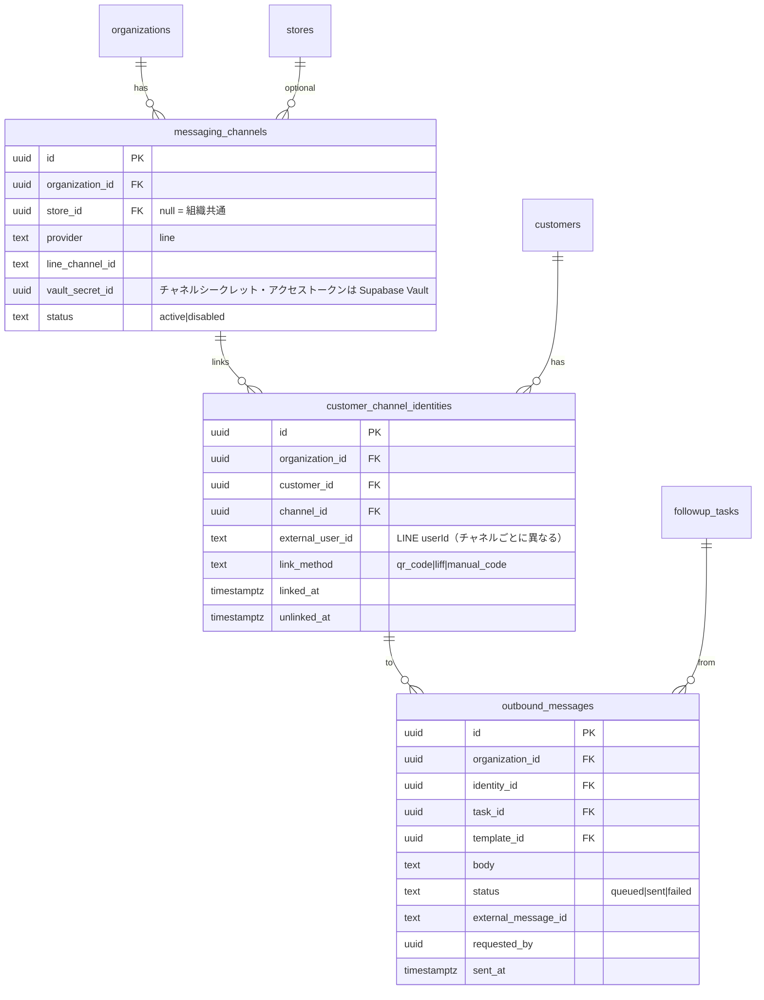

# 11. Phase 2：LINE 公式アカウント連携 拡張設計書

> Phase 1 では LINE API・Webhook・LINE ログイン・自動送信を**一切実装していません**。本書は Phase 2 の設計案です。

## 1. 目的と範囲
- スタッフが Phase 1 で「コピー → LINE で手動送信 → 記録」していた流れを、アプリからの送信に置き換える
- 送信は**スタッフの操作による1件ずつの送信**から始め、一斉・自動送信は運用実績を見て段階的に導入
- 外部送信・課金を伴うため、各段階の開始前に承認を得る

## 2. Phase 1 で用意済みの拡張ポイント

| 項目 | 内容 |
|---|---|
| `contact_logs.external_message_id` | LINE のメッセージ ID を保存する列（Phase 1 は常に null、RLS でユーザーによる設定を禁止） |
| `contact_logs.channel` | `line_manual`（手動）を Phase 2 で `line_api` に追加して区別 |
| `consent_records.channel` | `line` 単位の同意・停止を記録可能（Phase 1 は `all` のみ判定に使用） |
| テンプレートの差し込み変数 | 送信時にそのまま利用（`renderTemplate`） |
| 抽出ロジック | `evaluateRule` の除外判定にチャネル別同意を追加するだけで対応可能 |
| 監査ログ | 汎用トリガー。新テーブルにも同じトリガーを設定する |

## 3. 追加するテーブル

- `unique (channel_id, external_user_id)`、`unique (customer_id, channel_id) where unlinked_at is null`
- RLS は Phase 1 と同じ `app.customer_visible()` を利用。`messaging_channels` の閲覧・編集は org_admin のみ
- LINE userId は個人情報として扱い、画面には表示しない

## 4. 顧客と LINE の紐付け（安全な方式）
1. 店舗が顧客ごとに**ワンタイムの連携コード**（有効期限24時間）を発行し、QR コードで提示
2. 顧客が LINE 公式アカウントを友だち追加し、コードを送信（または LIFF で連携）
3. Webhook で受信したコードと userId を照合し、`customer_channel_identities` を作成
4. 電話番号・氏名の一致による**自動紐付けは行わない**（取り違え防止）

## 5. Webhook
- `POST /api/line/webhook/{channelId}`：`X-Line-Signature` を HMAC-SHA256 で検証、検証失敗は 401
- `follow` / `unfollow`（ブロック）イベント → `unfollow` は LINE チャネルの同意を `unsubscribed` として記録し、未完了の LINE 送信タスクを対象外へ
- 受信メッセージ本文は保存しない（連携コードの照合のみ）

## 6. 送信
- タスク詳細の「LINE で送信」→ 確認画面（宛先・本文）→ 送信キューに登録 → サーバーで Messaging API（push）を呼び出し
- 送信前に必ず再判定：連携あり・同意あり・配信停止なし・組織が有効
- 送信結果を `outbound_messages` と `contact_logs`（channel=`line_api`、external_message_id）に記録
- 送信数の上限（組織ごと・日ごと）を `organizations.limits` で管理（LINE の料金プランに合わせる）

## 7. 段階的な導入
| 段階 | 内容 | 承認 |
|---|---|---|
| 2-1 | チャネル登録・連携コードによる紐付け・Webhook（受信のみ） | 要 |
| 2-2 | スタッフ操作による1件送信 | 要（外部送信） |
| 2-3 | 抽出タスクからの一括送信（確認画面あり） | 要 |
| 2-4 | 完全自動送信（初回お礼など限定） | 要 |
