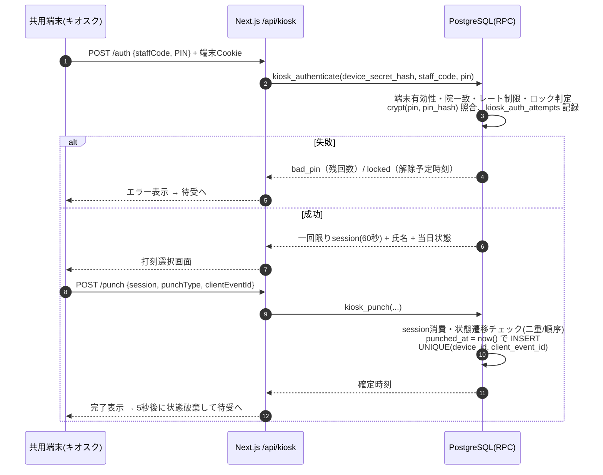
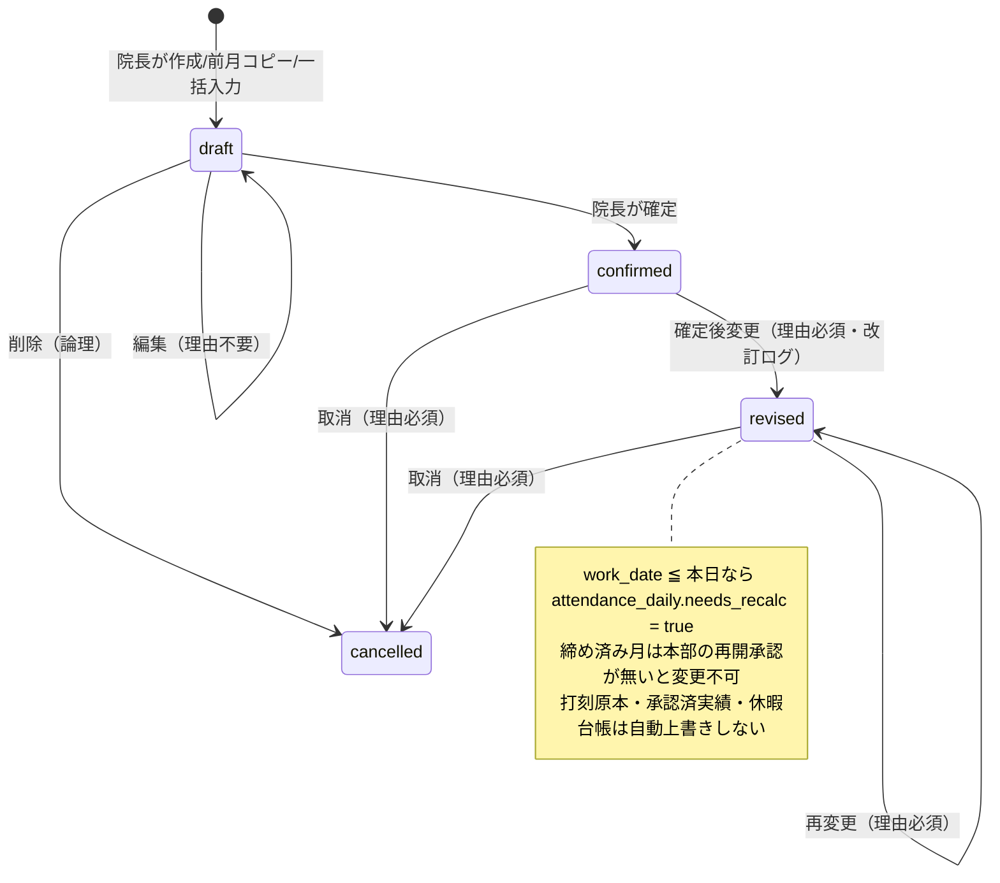
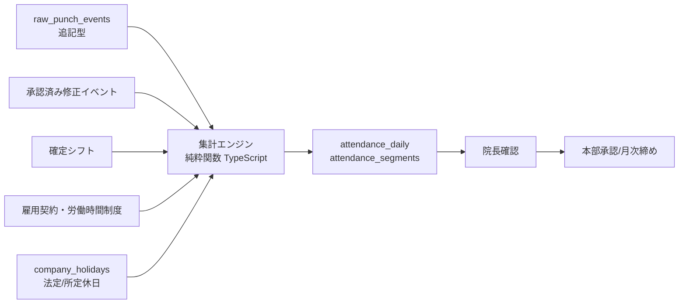
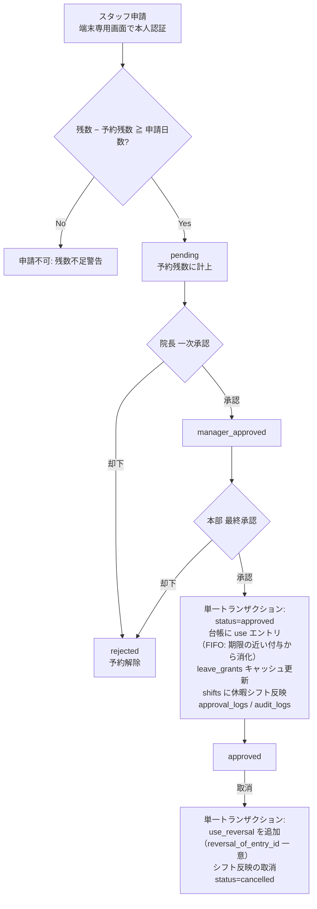
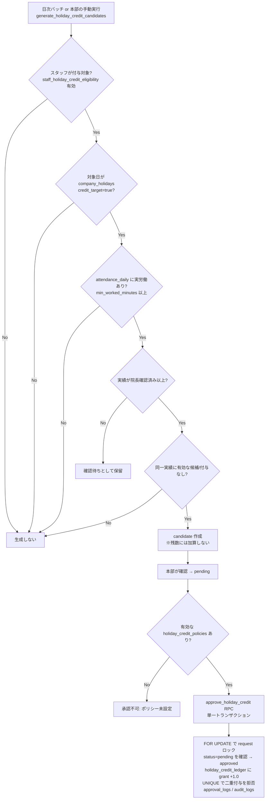
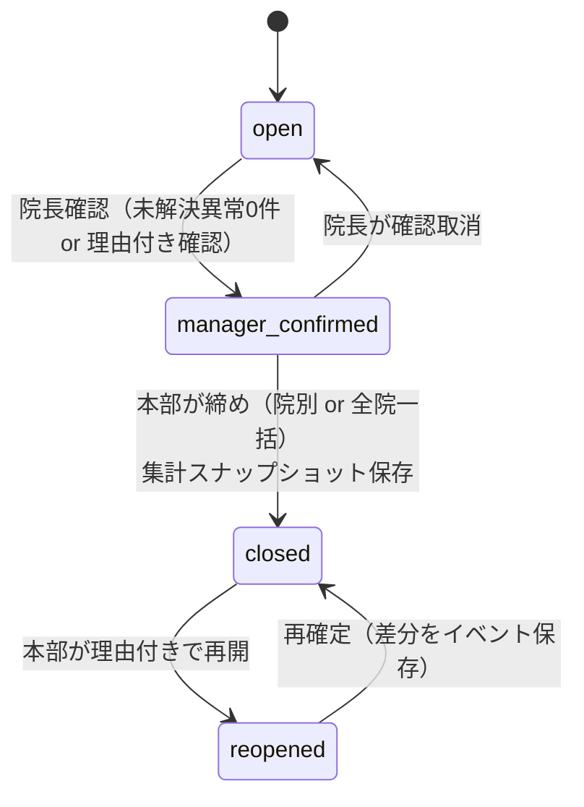

# あんど整骨院グループ 統合勤怠管理システム Ver.2.0 設計書（初版・確認用）

- 対象：株式会社Enejoy Hand「あんど整骨院グループ」全7院
- 作成日：2026-10-18
- ステータス：**フェーズ1〜4 実装済み**（フェーズ5以降は未着手）
- 配置：本リポジトリの `attendance/` 配下に独立したNext.jsアプリとして実装する（既存の予約システム・`body-check/` とはコード・DBとも分離）

目次

1. [要件定義書](#1-要件定義書)
2. [画面構成一覧](#2-画面構成一覧)
3. [権限マトリクス](#3-権限マトリクス)
4. [データベースER図](#4-データベースer図)
5. [勤怠・休暇処理フロー](#5-勤怠休暇処理フロー)
6. [未確定の就業規則・業務ルール](#6-未確定の就業規則業務ルール)
7. [開発フェーズ別タスク一覧](#7-開発フェーズ別タスク一覧)
8. [フェーズ1の具体的な実装計画](#8-フェーズ1の具体的な実装計画)

---

## 1. 要件定義書

### 1.1 目的

全7院のスタッフが共用端末で簡単・確実に打刻でき、院長が担当院のシフトを管理し、本部事務が全院の勤怠・有給・祝日勤務休日を一元管理・月次締め・出力できる、監査可能で改ざん耐性のある勤怠基盤を構築する。

### 1.2 確定業務要件（変更不可）

| No | 要件 | 設計上の担保 |
|---|---|---|
| R1 | シフト作成者は各院の院長 | `user_roles` に院単位の `clinic_manager` を付与、シフト作成RPC・RLSで担当院を判定 |
| R2 | 院長は所属院のシフトを作成・確定・編集できる | 同上。確定後編集は理由必須＋改訂ログ |
| R3 | 一般スタッフはシフトを直接編集・削除できない | `shifts` に staff 向け INSERT/UPDATE/DELETE ポリシーを作らない。API層でも拒否 |
| R4 | 出退勤・休憩打刻は各院の共用端末で行う | キオスク端末登録＋端末シークレット＋スタッフID/PIN。個人端末からの打刻APIは存在しない |
| R5 | 祝日勤務の休日付与は本部承認後に1日付与 | 候補→承認待ち→承認。承認RPC内で台帳加算（単一トランザクション） |
| R6 | 付与はスタッフ別の対象設定で制御 | `staff_holiday_credit_eligibility`（期間付き設定） |
| R7 | 対象外スタッフには自動付与しない | 候補生成条件に対象設定ONを必須。勤務制度名では判定しない |
| R8 | 本部は全院のシフト・勤怠・有給・振替休日残数を一元管理 | `hq_admin` は全院RLS許可 |
| R9 | 全院一括の月次締め・集計・CSV/Excel出力 | `monthly_closings` と出力ジョブ |

### 1.3 機能要件一覧

| 区分 | 機能 | 主な要件 |
|---|---|---|
| 店舗マスタ | 院の登録・名称変更・休止・閉鎖 | UUID主キー。名称は `clinic_name_history` で履歴化。閉鎖院は物理削除しない |
| スタッフマスタ | 基本情報・所属・雇用契約・PIN | 個人情報は `staff_private_details` に分離（院長は担当院主所属者のみ閲覧） |
| 所属・兼務 | 主所属・応援・異動・院長兼務 | `staff_clinic_assignments`（期間・種別）、`user_roles`（院単位で複数可） |
| 共用端末 | 端末登録・キオスクモード・打刻 | 端末シークレットはハッシュ保存。サーバー時刻確定。冪等キーによる二重送信防止 |
| シフト | 月間カレンダー／スタッフ別一覧、前月コピー、パターン、一括入力、確定、改訂 | 楽観ロック（version）、改訂ログ、警告（未作成・重複・休憩不足） |
| 勤怠実績 | 打刻原本（追記型）、日次実績、修正申請 | 原本はUPDATE/DELETE禁止（トリガー＋権限）。修正は申請・承認 |
| 集計 | 日別・月別の各種時間 | 法定/所定の区別、深夜・休日・法定外・60h超を分離 |
| 有給 | 付与予定計算・比例付与・申請・二段階承認・半日・時間単位（条件付）・失効・年5日管理 | 付与単位（バケット）＋台帳エントリで再計算可能 |
| 祝日勤務休日 | 候補生成・承認・台帳・取消・不整合検出 | 部分一意制約で重複付与防止。法的区分を分離 |
| 休暇申請 | 端末専用画面からの申請、院長一次・本部最終承認、シフト反映 | 申請中の予約残数を考慮 |
| ダッシュボード | 全院KPI、フィルタ、一括承認 | 一括でも個別に `approval_logs` |
| 月次締め | 院長確認→本部締め、院別・全院一括、再開 | 締め済み期間への書込をDBトリガーで拒否 |
| 出力 | CSV（UTF-8 BOM / Shift_JIS(CP932)）・Excel(.xlsx) | 9種の帳票 |
| 監査 | 全変更の監査ログ | `audit_logs`（追記型）、過去日付操作を明示 |

### 1.4 非機能要件

| 項目 | 要件 |
|---|---|
| セキュリティ | 権限判定を UI・API（Route Handler / Server Action）・DB（RLS＋SECURITY DEFINER RPC）の三層で実施。service_role キーはサーバー専用 |
| 認証 | 管理画面：Supabase Auth（メール＋パスワード、本部・院長はMFA推奨）。キオスク：端末シークレット＋スタッフID＋PIN |
| PIN | 6桁推奨（4桁も設定可）。bcrypt（pgcrypto `crypt()`/`gen_salt('bf', 10)`）でハッシュ。5回連続失敗で15分ロック。端末単位のレート制限も併用 |
| 時刻 | 打刻は `timestamptz`（UTC保存）、表示は Asia/Tokyo。業務日付（work_date等）は `date` 型で日本時間基準 |
| 整合性 | 残数・承認・台帳加算は単一トランザクション。重複は一意制約で物理的に防止 |
| 監査性 | 打刻原本・台帳・監査ログは追記型。訂正は「取消エントリ＋新エントリ」で表現 |
| 可用性 | 端末は通信断時にローカルキューで保持し再送。ただしローカル時刻は「参考値」 |
| 性能 | 7院・数十〜百名規模。月次集計は数秒以内、ダッシュボードは1秒台を目標 |
| 保存期間 | 労基法109条により賃金台帳・出勤簿等は5年（当分の間3年）保存。本システムは原則削除しない |
| 端末 | iPad/Androidタブレット/PCのブラウザ（Chrome/Safari最新版）。PWA化してホーム画面起動 |
| 個人情報 | 院長は他院主所属スタッフの個人情報を取得不可（応援者は氏名・スタッフコードのみ） |

### 1.5 技術構成

| 層 | 採用技術 |
|---|---|
| フロント/サーバー | Next.js（App Router）＋ TypeScript ＋ Tailwind CSS |
| 認証 | Supabase Auth（`@supabase/ssr`） |
| DB | Supabase PostgreSQL ＋ RLS ＋ PL/pgSQL RPC |
| バリデーション | Zod（API入力・フォーム・環境変数） |
| 出力 | CSV：自前実装（UTF-8 BOM / CP932は `iconv-lite`）、Excel：`exceljs` |
| 祝日 | 内閣府公表の祝日を `company_holidays` に取込（会社独自の休業日・指定祝日も同表で管理） |
| テスト | Vitest（ロジック単体／DB・RLS統合）、Playwright（E2E・キオスク） |
| ホスティング | Vercel（`attendance/` をルートディレクトリとする別プロジェクト） |

---

## 2. 画面構成一覧

### 2.1 共用端末（キオスク）— `/kiosk/*`

管理画面とは別レイアウト・別認証。管理画面へのリンクは一切置かない。

| ID | 画面 | 内容 |
|---|---|---|
| K-01 | 端末セットアップ | 管理者が発行したワンタイム登録コードを入力し端末を有効化（以後は端末シークレットをhttpOnly Cookie＋IndexedDBで保持） |
| K-02 | 待受画面 | 院名・現在時刻（サーバー同期）・「打刻」「休暇申請」ボタンのみ。通信状態表示 |
| K-03 | スタッフ認証 | スタッフID入力 → PIN入力（テンキー、マスク表示） |
| K-04 | 打刻選択 | 本人の氏名と当日の状態のみ表示。出勤／休憩開始／休憩終了／退勤（状態に応じ押下可否制御） |
| K-05 | 打刻完了 | 「○○さん 出勤 9:01」を表示し**5秒後に自動でK-02へ戻る**。メモリ・状態を完全破棄 |
| K-06 | 休暇申請（端末専用） | 改めて本人認証 → 種別（有給・祝日勤務休日・その他）・日付・全日/半日 → 残数（予約考慮後）表示 → 申請 |
| K-07 | エラー／ロック | PINロック中、通信断、端末無効化の案内 |

自動リセット条件：完了後5秒／無操作30秒／ブラウザ非表示時。いずれも `sessionStorage`・React state・キャッシュをクリアし、ブラウザ履歴も置換（戻るボタンで前の人の画面が出ない）。

### 2.2 管理画面（共通）— `/(app)/*`

| ID | 画面 | 主な利用者 |
|---|---|---|
| A-01 | ログイン／パスワード再設定 | 全ロール |
| A-02 | マイページ（自分のシフト・勤怠・残数・申請状況） | staff（個人アカウント運用時） |

### 2.3 院長向け — `/manager/*`

| ID | 画面 | 内容 |
|---|---|---|
| M-01 | 院ホーム | 担当院の当日出勤予定・出勤済・未打刻・遅刻早退、承認待ち件数。兼務院長は院切替 |
| M-02 | シフト：月間カレンダー | 院×月のカレンダー。ドラッグ／セル入力、警告アイコン |
| M-03 | シフト：スタッフ別一覧 | 行=スタッフ、列=日付のグリッド。複数スタッフ一括入力 |
| M-04 | 勤務パターン管理 | 早番・遅番・通し等のテンプレート |
| M-05 | 前月コピー／一括入力ウィザード | コピー元・対象スタッフ・曜日指定 |
| M-06 | シフト確定・改訂 | 一括確定、確定後編集時の理由入力、再計算要否表示、改訂履歴 |
| M-07 | 日次勤怠確認 | 打刻原本と実績の対比、異常（打刻漏れ等）、院長確認 |
| M-08 | 勤怠修正申請（作成・一次承認） | 修正前後、理由 |
| M-09 | 休暇申請一次承認 | 有給・祝日勤務休日・その他 |
| M-10 | 月次院長確認 | 未解決異常の一覧→「院長確認済み」 |

### 2.4 本部向け — `/hq/*`

| ID | 画面 | 内容 |
|---|---|---|
| H-01 | 統合ダッシュボード | 院別スタッフ数、出勤予定/済/未打刻、遅刻早退、各種承認待ち、残数一覧、月間勤務・残業、締め状況。院・スタッフ・期間フィルタ |
| H-02 | 一括承認センター | 勤怠修正・有給・祝日勤務休日をタブで一覧、複数選択→一括承認（個別ログ） |
| H-03 | 全院シフト閲覧 | 院長と同UI（閲覧＋締め再開後の修正） |
| H-04 | 全院勤怠一覧・スタッフ別明細 | 日別・月別集計 |
| H-05 | 有給台帳 | 付与バケット別残数、付与予定、年5日義務の進捗、失効予定 |
| H-06 | 祝日勤務休日台帳 | 候補生成・承認・取消・不整合検出 |
| H-07 | 月次締め | 院別／全院一括締め、再開（理由必須）、履歴 |
| H-08 | 出力センター | 9帳票 × CSV(UTF-8 BOM / CP932) / Excel |
| H-09 | 監査ログ閲覧 | 対象・操作者・期間で検索 |

### 2.5 マスタ・管理 — `/admin/*`（hq_admin / super_admin）

| ID | 画面 | 内容 |
|---|---|---|
| S-01 | 店舗マスタ | 追加・名称変更（履歴）・休止・閉鎖 |
| S-02 | スタッフマスタ | 基本情報・個人情報・スタッフコード・PIN再発行・ロック解除・祝日勤務付与対象設定 |
| S-03 | 所属・応援・異動 | 期間付き所属の登録 |
| S-04 | 雇用契約・勤務条件 | 雇用形態、週所定日数/時間、労働時間制度、法定休日の曜日、時間単位年休可否 |
| S-05 | ユーザー・ロール | 管理画面アカウントとロール（院単位） |
| S-06 | 共用端末管理 | 端末登録コード発行・無効化・最終通信 |
| S-07 | 会社カレンダー | 祝日取込、会社指定祝日、休業日 |
| S-08 | 休暇ポリシー | 有給付与表、半日/時間単位の可否、祝日勤務休日ポリシー（区分・期限） |
| S-09 | システム設定（super_admin） | 締め日、PIN桁数、ロック閾値、端末自動リセット秒数 |

---

## 3. 権限マトリクス

凡例：◎=全院可 ／ ○=担当院のみ可 ／ △=本人分のみ ／ 申=申請のみ ／ ×=不可 ／ 閲=閲覧のみ

「担当院」＝ `user_roles` で `clinic_manager` を付与された院（兼務可）。

| 操作 | super_admin | hq_admin | clinic_manager | staff | kiosk端末 |
|---|---|---|---|---|---|
| 店舗マスタ 閲覧 | ◎ | ◎ | ○（院名のみ全院） | × | 自院のみ |
| 店舗 追加・休止・閉鎖 | ◎ | ◎ | × | × | × |
| スタッフ基本情報（氏名・コード）閲覧 | ◎ | ◎ | ○（主所属＋応援登録者） | △ | 認証成功した本人のみ |
| スタッフ個人情報（住所・電話・生年月日等）閲覧 | ◎ | ◎ | ○（**主所属者のみ**） | △ | × |
| スタッフ登録・異動・契約変更 | ◎ | ◎ | × | × | × |
| PIN再発行・ロック解除 | ◎ | ◎ | ○（ロック解除のみ） | × | × |
| ロール付与 | ◎ | 院長・staffのみ | × | × | × |
| 端末登録・無効化 | ◎ | ◎ | × | × | × |
| シフト 閲覧 | ◎ | ◎ | ○ | △（確定済のみ） | × |
| シフト 作成・編集・確定・取消 | ◎ | ◎（締め再開時・代行） | ○ | **×（API・RLSで拒否）** | × |
| 確定後シフト変更 | ◎ | ◎ | ○（理由必須） | × | × |
| 締め済み月のシフト変更 | 再開後のみ | 再開後のみ | 再開後のみ | × | × |
| 打刻 | × | × | × | × | ○（認証済本人・自院端末） |
| 打刻原本 閲覧 | ◎ | ◎ | ○（実勤務院が担当院 or 主所属者） | △ | × |
| 打刻原本 変更・削除 | **×（DBで禁止）** | × | × | × | × |
| 勤怠修正 申請 | ◎ | ◎ | ○ | 申（個人アカウント運用時） | × |
| 勤怠修正 一次承認 | ◎ | ◎ | ○ | × | × |
| 勤怠修正 最終承認 | ◎ | ◎ | ×（設定で院長最終も可） | × | × |
| 日次勤怠 院長確認 | ◎ | ◎ | ○ | × | × |
| 有給 申請 | ◎（代理） | ◎（代理） | ○（代理） | 申 | 申（端末専用画面） |
| 有給 一次承認 | ◎ | ◎ | ○ | × | × |
| 有給 最終承認 | ◎ | ◎ | × | × | × |
| 有給 手動付与・調整 | ◎ | ◎ | × | × | × |
| 祝日勤務休日 候補閲覧 | ◎ | ◎ | ○ | △ | × |
| 祝日勤務休日 承認（付与） | ◎ | ◎ | **×** | × | × |
| 付与対象設定の変更 | ◎ | ◎ | × | × | × |
| 院長確認（月次） | ◎ | ◎ | ○ | × | × |
| 月次締め・再開 | ◎ | ◎ | × | × | × |
| ダッシュボード | ◎ | ◎ | ○（院ホーム） | × | × |
| CSV/Excel出力 | ◎ | ◎ | ○（担当院分の勤怠のみ） | × | × |
| 監査ログ閲覧 | ◎ | ◎ | × | × | × |
| システム設定 | ◎ | × | × | × | × |

**実装方針（三層防御）**

1. **UI**：権限のない操作は表示しない（UX目的。セキュリティ境界ではない）。
2. **API**：Server Action / Route Handler でセッション取得→Zod検証→権限チェック関数（`assertCanEditShift` 等）→RPC呼出。サーバー側でも拒否。
3. **DB**：全テーブルRLS有効化（デフォルト拒否）。判定ヘルパー関数（`SECURITY DEFINER`, `search_path` 固定）：
   - `app.current_staff_id()`、`app.has_role(role)`、`app.is_hq()`（super_admin or hq_admin）
   - `app.managed_clinic_ids()`：有効な clinic_manager ロールの院ID集合
   - `app.can_view_staff_basic(staff_id)`、`app.can_view_staff_private(staff_id)`
   - 書込を伴う業務処理（確定・承認・付与・締め）は RLS直書きではなく **RPC関数**内で権限再判定＋状態遷移＋監査ログ記録をまとめて実行。

---

## 4. データベースER図

### 4.1 全体ER図（主要リレーション）

```mermaid
erDiagram
  clinics ||--o{ clinic_name_history : "名称履歴"
  clinics ||--o{ staff_clinic_assignments : ""
  clinics ||--o{ kiosk_devices : ""
  clinics ||--o{ shifts : ""
  clinics ||--o{ raw_punch_events : "実勤務院"
  clinics ||--o{ monthly_closings : ""
  clinics ||--o{ user_roles : "院単位ロール"

  staff_profiles ||--|| staff_private_details : "個人情報(分離)"
  staff_profiles ||--o{ staff_clinic_assignments : "主所属/応援/異動"
  staff_profiles ||--o{ employment_contracts : "勤務条件(期間)"
  staff_profiles ||--|| kiosk_credentials : "PINハッシュ"
  staff_profiles ||--o{ staff_holiday_credit_eligibility : "付与対象設定"
  staff_profiles ||--o{ shifts : ""
  staff_profiles ||--o{ raw_punch_events : ""
  staff_profiles ||--o{ attendance_daily : ""
  staff_profiles ||--o{ leave_grants : ""
  staff_profiles ||--o{ leave_requests : ""
  staff_profiles ||--o{ holiday_credit_requests : ""

  user_roles }o--|| auth_users : "Supabase Auth"
  staff_profiles |o--o| auth_users : "管理画面ログイン(任意)"

  shift_templates ||--o{ shifts : "パターン"
  shifts ||--o{ shift_revision_logs : "改訂履歴"

  kiosk_devices ||--o{ raw_punch_events : "打刻端末"
  kiosk_devices ||--o{ kiosk_auth_attempts : "認証ログ"

  attendance_daily ||--o{ attendance_segments : "院別勤務区間"
  attendance_daily ||--o{ attendance_adjustment_requests : "修正申請"
  raw_punch_events }o--o{ attendance_segments : "集計元"

  leave_policies ||--o{ leave_grants : ""
  leave_grants ||--o{ leave_ledger_entries : "付与/使用/失効/調整"
  leave_requests ||--o{ leave_ledger_entries : "使用/返還"

  company_holidays ||--o{ holiday_credit_requests : "対象祝日"
  attendance_daily ||--o{ holiday_credit_requests : "根拠実績"
  holiday_credit_policies ||--o{ holiday_credit_requests : ""
  holiday_credit_requests ||--o{ holiday_credit_ledger : "承認時に加算"

  approval_logs }o--|| staff_profiles : "対象者"
  monthly_closings ||--o{ monthly_closing_events : "締め/再開履歴"
```



### 4.2 テーブル定義（主要カラム）

> 共通：主キーは `uuid`（`gen_random_uuid()`）。`created_at`/`updated_at` は `timestamptz`。業務日付は `date`（JST）。日数は `numeric(5,2)`（半日=0.5）、時間は分単位の `integer`。

#### マスタ・権限

| テーブル | 主なカラム | 制約・備考 |
|---|---|---|
| **clinics** | clinic_id PK, clinic_code UNIQUE, name, status(`active`/`suspended`/`closed`), opened_on, suspended_on, closed_on, timezone='Asia/Tokyo', display_order | 履歴は clinic_id で紐付くため名称変更しても過去データ保持。DELETE禁止 |
| clinic_name_history（追加） | clinic_id, name, valid_from, valid_to, changed_by | 帳票で「当時の院名」を出せるように |
| **staff_profiles** | staff_id PK, staff_code UNIQUE（キオスク入力用ID）, auth_user_id UNIQUE NULL, family_name, given_name, kana, hire_date, retire_date, status(`active`/`on_leave`/`retired`) | 業務上必要な最小限の基本情報 |
| staff_private_details（追加） | staff_id PK/FK, birth_date, phone, email, address, emergency_contact | 院長は**主所属院の院長のみ**閲覧（要件17） |
| **staff_clinic_assignments** | assignment_id, staff_id, clinic_id, assignment_type(`primary`/`support`), valid_from, valid_to | 主所属は同期間に1件のみ（`EXCLUDE USING gist (staff_id WITH =, daterange(valid_from, valid_to, '[]') WITH &&) WHERE assignment_type='primary'`）。異動＝旧レコード終了＋新レコード |
| **employment_contracts** | contract_id, staff_id, valid_from, valid_to, employment_type(`full_time`/`part_time`/`contract`…), working_time_system(`standard`/`monthly_variable`/`flex`…), weekly_scheduled_days, weekly_scheduled_minutes, daily_scheduled_minutes, legal_weekly_limit_minutes（2400 or 2640＝特例44h）, legal_holiday_rule（曜日 or 4週4休）, hourly_leave_enabled | 期間重複不可（EXCLUDE）。集計は勤務日時点の契約を参照 |
| staff_holiday_credit_eligibility（追加） | id, staff_id, eligible bool, valid_from, valid_to, reason, set_by | 要件R6/R7。**勤務制度名では判定しない**ため独立管理 |
| app_accounts（追加） | user_id PK(auth.users), email, display_name, disabled | auth.users はクライアントから読めないため表示用に保持。disabled のアカウントはロール無効扱い |
| **user_roles** | id, user_id(auth.users), role(`super_admin`/`hq_admin`/`clinic_manager`/`staff`), clinic_id NULL, valid_from, valid_to, granted_by | clinic_manager は clinic_id 必須（CHECK）。兼務＝複数行。同一ロール・同一院の期間重複は EXCLUDE で禁止。行は削除せず valid_to で失効 |

#### 共用端末

| テーブル | 主なカラム | 制約・備考 |
|---|---|---|
| **kiosk_devices** | device_id, clinic_id, name, secret_hash, status(`pending`/`active`/`disabled`), registration_code_hash, registration_expires_at, last_seen_at, registered_by | 端末シークレットは256bit乱数、DBにはSHA-256ハッシュのみ |
| **kiosk_credentials** | staff_id PK, pin_hash（bcrypt）, pin_set_at, failed_count, locked_until, must_change bool | 平文PIN保存禁止。スタッフ自身も閲覧不可（RPC経由のみ） |
| kiosk_auth_attempts（追加） | id, device_id, staff_code_input, staff_id NULL, result(`success`/`bad_pin`/`unknown_id`/`locked`/`device_invalid`), created_at | 操作ログ。端末単位レート制限に使用 |
| kiosk_sessions（追加） | session_id, device_id, staff_id, purpose(`punch`/`leave`), expires_at(+60秒), consumed_at | PIN認証成功で発行する**一回限り・短命**トークン。打刻1回で失効 |

#### シフト

| テーブル | 主なカラム | 制約・備考 |
|---|---|---|
| **shift_templates** | template_id, clinic_id NULL（NULL=全院共通）, name, start_time, end_time, crosses_midnight, break_minutes, color | |
| **shifts** | shift_id, staff_id, clinic_id, work_date, scheduled_start timestamptz, scheduled_end timestamptz, scheduled_break_minutes, shift_type(`work`/`paid_leave`/`holiday_credit_leave`/`legal_holiday`/`scheduled_holiday`/`other_leave`), status(`draft`/`confirmed`/`revised`/`cancelled`), version int, template_id, created_by, confirmed_by, confirmed_at, updated_at | CHECK(scheduled_end > scheduled_start AND 長さ≦24h)。翌日終了は timestamptz で自然に表現。work_date＝開始のJST日付。同一スタッフの有効シフト時間帯重複は警告（応援で院が違っても）＋DB側はEXCLUDE（status≠cancelled）で物理防止 |
| **shift_revision_logs** | id, shift_id, version_before, version_after, action(`create`/`update`/`confirm`/`cancel`), before jsonb, after jsonb, reason, requires_recalc bool, changed_by, changed_at | 確定後変更は reason NOT NULL（RPCで強制） |

#### 打刻・勤怠

| テーブル | 主なカラム | 制約・備考 |
|---|---|---|
| **raw_punch_events** | event_id, staff_id, clinic_id（**実打刻院**）, home_clinic_id（打刻時点の主所属院スナップショット）, device_id, punch_type(`clock_in`/`break_start`/`break_end`/`clock_out`), punched_at（**サーバー確定時刻** = `now()`）, client_event_id UUID, device_reported_at（参考値）, is_delayed_submission bool, source(`kiosk`/`adjustment`), created_at | **追記型**：UPDATE/DELETE をトリガーで常時拒否、権限も REVOKE。UNIQUE(device_id, client_event_id) で再送の冪等化 |
| **attendance_daily** | attendance_id, staff_id, work_date, first_clock_in, last_clock_out, break_minutes, worked_minutes, scheduled_minutes, within_scheduled_minutes, overtime_non_statutory_minutes（所定外・法定内）, overtime_statutory_minutes（法定時間外）, late_night_minutes, legal_holiday_minutes, scheduled_holiday_minutes, late_minutes, early_leave_minutes, is_absent, has_missing_punch, anomaly_flags jsonb, day_type(`workday`/`legal_holiday`/`scheduled_holiday`/`company_holiday`), status(`open`/`manager_confirmed`/`hq_approved`/`closed`), needs_recalc bool, calc_version int, row_version int, confirmed_by/at | UNIQUE(staff_id, work_date)。打刻原本＋承認済修正から**再生成可能**な派生テーブル |
| attendance_segments（追加） | segment_id, attendance_id, clinic_id, clock_in, clock_out, break_minutes | 1日に複数院勤務（午前A院・午後B院）に対応。応援勤務の院別集計に使用 |
| **attendance_adjustment_requests** | request_id, staff_id, work_date, clinic_id, target_event_id NULL, change_type(`add`/`void`/`replace`), before jsonb, after jsonb（修正後時刻）, reason, status(`pending`/`manager_approved`/`approved`/`rejected`/`cancelled`), requested_by, approved_by, approved_at | 承認時に raw_punch_events に `source='adjustment'` の新イベント（および void 参照）を**追記**し、原本自体は書き換えない |

#### 休暇

| テーブル | 主なカラム | 制約・備考 |
|---|---|---|
| **leave_policies** | policy_id, leave_type(`paid`/`special`…), name, grant_table jsonb（勤続月数→日数、比例付与表）, half_day_allowed, hourly_allowed（労使協定フラグ）, hourly_max_days_per_year（上限5日）, agreement_ref, valid_from/to | 時間単位年休は `hourly_allowed=true` かつ契約側 `hourly_leave_enabled` の両方が必要 |
| **leave_grants** | leave_grant_id, staff_id, policy_id, grant_date, granted_days, used_days, expired_days, expiration_date（原則 grant_date + 2年 − 1日）, grant_type(`statutory`/`proportional`/`advance`/`manual`/`migration`), annual_5day_target bool, created_by | used_days/expired_days は台帳エントリから算出する**キャッシュ**（RPCで同一トランザクション更新＋整合性チェック関数） |
| **leave_requests** | leave_request_id, staff_id, leave_type, start_date, end_date, unit(`full`/`am`/`pm`/`hour`), hours, days_requested, status(`pending`/`manager_approved`/`approved`/`rejected`/`cancelled`/`withdrawn`), requested_via(`kiosk`/`web`/`proxy`), manager_approved_by/at, hq_approved_by/at, cancelled_by/at, cancel_reason | 申請中（pending/manager_approved）の日数を**予約残数**として控除 |
| **leave_ledger_entries** | entry_id, staff_id, leave_grant_id, leave_request_id NULL, entry_type(`grant`/`use`/`use_reversal`/`expire`/`adjust`), days（±）, minutes（±、時間単位用）, effective_date, reversal_of_entry_id UNIQUE NULL, note, created_by, created_at | **追記型**。残数＝Σdays。取消は `use_reversal` を追加し、`reversal_of_entry_id` の一意制約で**二重返還を物理的に防止** |

#### 祝日勤務休日

| テーブル | 主なカラム | 制約・備考 |
|---|---|---|
| **company_holidays** | holiday_date PK, name, holiday_kind(`national`/`company_designated`/`company_closed`), credit_target bool | 「会社指定の祝日」＝ credit_target=true の日 |
| **holiday_credit_policies** | policy_id, credit_type(`substitute_holiday`=法的振替休日 / `compensatory_day_off`=代休 / `company_holiday_work_leave`=会社独自の祝日勤務特別休暇), credited_days(=1), min_worked_minutes, expiration_rule（例：付与日から○か月）, wage_effect（none/割増対象 等、給与連携用メモ）, is_active, configured_by, valid_from/to | **is_active なポリシーが無い区分は承認不可**（候補生成までは可） |
| **holiday_credit_requests** | request_id, staff_id, policy_id, credit_type, source_work_date, source_attendance_id, source_attendance_row_version（承認時点）, status(`candidate`/`pending`/`approved`/`rejected`/`cancelled`), submitted_by/at, approved_by, approved_at, rejected_reason, cancelled_reason | 部分一意：UNIQUE(source_attendance_id, credit_type) WHERE status IN ('candidate','pending','approved') |
| **holiday_credit_ledger** | holiday_credit_id, staff_id, request_id NULL, source_work_date, source_attendance_id, credit_type, entry_type(`grant`/`use`/`use_reversal`/`expire`/`revoke`/`adjust`), credited_days（±）, approval_status（承認時点のスナップショット）, approved_by, approved_at, expiration_date, reversal_of_id UNIQUE NULL, created_at | 部分一意：UNIQUE(source_attendance_id, credit_type) WHERE entry_type='grant' → **同一勤務実績への二重付与をDB制約で防止**。取消は `revoke` エントリを追記（履歴保持） |

#### 承認・締め・監査

| テーブル | 主なカラム | 制約・備考 |
|---|---|---|
| **approval_logs** | id, target_table, target_id, step(`manager`/`hq`), action(`approve`/`reject`/`cancel`/`reopen`), actor_id, batch_id NULL（一括承認ID）, comment, created_at | 一括承認でも1件ずつ行を作る |
| **monthly_closings** | closing_id, clinic_id, year_month（`date` 月初）, period_start, period_end, status(`open`/`manager_confirmed`/`closed`/`reopened`), manager_confirmed_by/at, closed_by/at, reopen_count | UNIQUE(clinic_id, year_month) |
| monthly_closing_events（追加） | id, closing_id, action(`manager_confirm`/`close`/`reopen`/`reclose`), reason, actor_id, snapshot jsonb（締め時集計値）, created_at | 再開は reason NOT NULL |
| **audit_logs** | id, occurred_at, actor_user_id, actor_role, actor_kind(`user`/`kiosk`/`system`), action, table_name, record_id, before jsonb, after jsonb, reason, is_backdated bool, ip, user_agent | 追記型。過去日付の付与・修正は is_backdated=true |

### 4.3 整合性・制約の要点

- **締め済み期間ガード**：`shifts`/`attendance_daily`/`attendance_adjustment_requests`/`leave_ledger_entries` 等に BEFORE トリガー `app.assert_period_open(clinic_id, date)`。`monthly_closings.status='closed'` の期間への書込は例外送出（RLSの上位で常に働く）。
- **追記型テーブル**（raw_punch_events, leave_ledger_entries, holiday_credit_ledger, audit_logs, approval_logs, shift_revision_logs）：UPDATE/DELETE トリガーで拒否＋ `REVOKE UPDATE, DELETE`。
- **残数の再計算可能性**：`leave_balance(staff_id, as_of)` / `holiday_credit_balance(staff_id, credit_type, as_of)` は台帳の総和で算出。キャッシュ列との差異を検出する `app.check_ledger_consistency()` を夜間ジョブ＋テストで実行。
- **同時実行**：残数を動かすRPCは `SELECT … FROM staff_profiles WHERE staff_id=$1 FOR UPDATE` でスタッフ単位に直列化。
- **楽観ロック**：`shifts.version`、`attendance_daily.row_version` を `WHERE version = $expected` で更新し、不一致は競合エラー。

---

## 5. 勤怠・休暇処理フロー

### 5.1 共用端末打刻フロー



**二重打刻防止**

- 状態遷移：`未出勤 → 出勤 → (休憩開始 ⇄ 休憩終了)* → 退勤`。不正遷移（出勤中の再出勤等）は拒否。
- 同一スタッフ・同一種別が**120秒以内**に再送された場合は既存イベントを返す（ボタン連打対策）。
- `client_event_id` によるリクエスト冪等性（再送しても1件）。

**通信障害時**

1. 認証APIが通信不可の場合は打刻不可（オフラインでPIN照合はしない＝PINハッシュを端末に置かない）。
2. 認証成功後、打刻送信で失敗した場合：`client_event_id`・`device_reported_at` を IndexedDB に保存し、指数バックオフで自動再送（session は再送専用に延長せず、**キュー送信用の端末署名付き**で送る）。
3. サーバーは受信時刻を `punched_at` とし、`device_reported_at` との差が閾値（例：2分）超なら `is_delayed_submission=true` として**異常一覧に表示**。端末時刻を正式時刻にするには院長が修正申請を承認する必要がある（無条件採用しない）。
4. 端末画面に「未送信 n 件」を常時表示。

### 5.2 シフト作成・確定・改訂フロー



### 5.3 勤怠集計フロー



集計ロジック（初期実装＝通常の労働時間制。変形労働時間制は設定確定後に追加）

| 項目 | 算出 |
|---|---|
| 実休憩 | 休憩開始〜終了の合計（終了漏れは異常） |
| 実労働 | 出勤〜退勤 − 実休憩（区間合計） |
| 所定内 | 実労働のうちシフト所定時間内 |
| 所定外（法定内） | 所定超〜1日8h（または契約上の法定上限）以内 |
| 法定時間外 | 1日8h超 ＋ 週40h（特例事業場は44h）超（日で計上済み分を除く）。月60h超は別枠集計 |
| 深夜 | 22:00〜翌5:00 の実労働（JST） |
| 休日労働 | **法定休日**の実労働（35%割増対象）。所定休日の労働は「所定休日労働」として別計上（時間外判定の対象） |
| 遅刻／早退 | シフト開始後の出勤／シフト終了前の退勤（猶予分数は設定） |
| 欠勤 | 確定シフト（work）があり打刻なし、かつ承認済休暇なし |
| 打刻漏れ | 出勤のみ・退勤のみ・休憩終了なし 等 |
| 休憩不足警告 | 実労働6h超で45分未満、8h超で60分未満（労基法34条） |

### 5.4 休暇申請・承認フロー（有給・祝日勤務休日・その他）



### 5.5 祝日勤務休日 付与フロー



**取消・不整合検出**

- 付与後に根拠勤怠が修正・取消された場合：`attendance_daily.row_version` が承認時の `source_attendance_row_version` と異なる、または実労働が条件未満になった付与を `detect_holiday_credit_inconsistencies()` が検出し、本部ダッシュボードに表示。
- 本部が取消すると `revoke`（−1.0）エントリを追記。既に取得済みの場合は残数がマイナスになるため警告し、取得休暇の扱いを本部が判断（自動では取得を取り消さない）。

### 5.6 月次締めフロー



---

## 6. 就業規則・業務ルール

### 6.0 確定したルール（2026-10-19 回答）

| No | 回答内容 | システムでの扱い | 実装状況 |
|---|---|---|---|
| A1 | 診療時間は店舗ごとに異なる | `clinic_business_hours`：院×曜日（0〜6）＋祝日（7）ごとに最大2枠（午前・午後など）。適用開始日で履歴化し、変更前の日付は旧時間のまま参照 | ✅ 実装（本部が登録） |
| A2 | 休日は店舗ごとに調整する | 定休日＝枠の無い曜日。臨時休診・特別診療は `clinic_calendar_exceptions` で日付単位に上書き（**本部と担当院長**が登録可）。判定順は「臨時 → 祝日 → 曜日」（`clinic_hours_on()`） | ✅ 実装 |
| A3 | 所定労働時間は1日8時間・週5日（週40時間） | 通常の労働時間制。契約の既定値を 1日480分・週5日・週2400分に。1日8時間超・週40時間超は法定時間外 | ✅ 既定値。集計はフェーズ3 |
| A4 | みなし残業あり。対象は正社員で基本月24時間、人により異なる。変更は本部のみ | `employment_contracts.fixed_overtime_minutes`。正社員の標準1440分（空欄時に自動適用）、個別に変更可。変更は `set_employment_contract()`（本部のみ・理由必須・期間で履歴化）。月次集計で「法定時間外 − みなし時間」を**超過分（別途支給が必要）**として出力 | ✅ 勤務条件画面（スタッフ詳細）。集計はフェーズ3・6 |
| A5 | 祝日がある月は振休数を増やし、使えば減らし、使わなければ残る。原則当日使用。無理な場合は院長から上長に報告 | 下記 6.0.1 の解釈で実装（当日使用した場合は台帳に記録せず残数は変わらない） | ✅ フェーズ4 |
| A7 | 祝日の半日勤務は振休0.5日 | 実労働が `holiday_credit_policies.half_day_max_minutes`（既定240分＝4時間）以下なら0.5日、超えれば1日。休暇の設定画面で変更可 | ✅ |
| A8 | 既存の有給残数は最新のExcelから取り込めるようにする | `/hq/leave/import`：1行1付与（スタッフID・付与日・付与日数・取得済み日数／残日数・有効期限）。未登録は「移行」で登録、登録済みは差分を「調整」として追記（再取込可能・全件ロールバック） | ✅ |
| A6 | 当日使えなかった振休の期限は本来当月中。期限の変更・期限切れの扱いは本部が編集できる | `holiday_credit_ledger.expiration_date` の既定値＝祝日の属する月の末日。本部が個別に期限を変更（理由必須・監査ログ）。期限切れは自動失効せず「失効候補」として本部が確定 | ✅ フェーズ4 |

#### 6.0.1 祝日の振休（A5）の解釈案

| 状況 | 振休の動き | システム上の処理 |
|---|---|---|
| 祝日に休んだ（＝当日使用） | ＋1 してすぐ −1（残数は変わらない） | シフトで祝日を「振休（当日使用）」にすると、付与と使用を同時に記録 |
| 祝日に勤務した（当日使えなかった） | ＋1 が残る（後日使用） | 院長が「当日使用できなかった理由」を付けて上長（本部）へ報告 → 本部承認で台帳に＋1（確定仕様5「本部承認後に1日付与」と一致） |
| 残っている振休を後日使った | −1 | 休暇申請（院長一次→本部最終）で台帳から差し引く |

- 院が祝日休診の場合でも、対象スタッフには「祝日に休んだ」扱いで当日使用とする想定。
- 付与対象かどうかは引き続きスタッフ別の設定（`staff_holiday_credit_eligibility`）で判定し、勤務制度名では判定しない。
- 法的区分は「会社独自の祝日勤務特別休暇」として内部管理し、画面上の名称は社内呼称の「振休」とする（法律上の振替休日は事前に休日と労働日を入れ替える制度で、事後付与とは扱いが異なるため）。

---

以下は引き続き**会社（本部・社労士）の確認が必要な事項**です。未確定の間は「設定値として実装し、初期値は安全側（自動付与しない・承認必須）」で進めます。

### 6.1 労働時間・休日（最重要）

| No | 確認事項 | 影響 | 仮置き（初期値） |
|---|---|---|---|
| ~~Q1~~ | ~~労働時間制度~~ → **確定（A3）**：週5日・1日8時間の通常制 | — | — |
| Q2 | **週44時間の特例措置**（保健衛生業・常時10人未満の事業場）を適用している院があるか | 週の法定上限が院ごとに40h/44hで異なる | 40h（院・契約単位で設定可） |
| Q3 | **法定休日の特定**（確認中）：院ごとに異なる。確定後に本部が院ごとに登録する | 休日労働35%と時間外25%の区別 | `clinics.legal_holiday_weekday`（院カレンダー画面で本部が登録）。勤務条件の個別指定が優先。**未登録の間は法定休日労働を判定しない**（画面に注意表示） |
| Q3b | **みなし残業の範囲**：時間・対象者は確定（A4）。深夜・休日労働の割増もみなしに含むか | 超過分の算出 | 時間外労働のみを対象（深夜・休日は別途計算） |
| Q4 | 週の起算曜日 | 週40h判定 | 日曜起算 |
| Q5 | 遅刻・早退の猶予分数、丸め（1分単位が原則） | 遅刻早退・賃金控除 | 丸めなし（1分単位）、猶予0分 |
| Q6 | 休憩の打刻運用：毎回打刻か、シフトの所定休憩を自動控除するか | 実休憩の算出 | 打刻方式。打刻なし時は異常扱い（自動控除はしない） |
| Q7 | 締め日（末日締めか20日締め等）と支払日 | 月次締め期間 | 末日締め |
| Q8 | 勤怠修正の最終承認者（院長で完結か本部まで必要か） | 承認フロー | 院長一次→本部最終 |

### 6.2 祝日勤務に伴う休日（最重要）

| No | 確認事項 | 補足 |
|---|---|---|
| Q9 | 付与する休日の**法的区分**（6.0.1 の解釈案では「会社独自の祝日勤務特別休暇」として扱う） | 祝日は法律上当然に休日ではない（就業規則で休日と定めた場合のみ休日）。祝日を休日と定めていない場合、本件は会社独自の特別休暇とするのが自然。法定休日に当たる日を事後に休ませる場合は「代休」で、休日労働の割増賃金は消えない。事前に休日と労働日を入れ替える場合のみ「振替休日」 |
| Q10 | 対象となる「会社指定の祝日」：国民の祝日すべてか、GW・年末年始の扱い、振替休日（国民の祝日法上）・国民の休日を含むか | `company_holidays.credit_target` の初期値 |
| ~~Q11~~ | ~~半日勤務時の扱い~~ → **確定（A7）**：0.5日 | 要件上は「1日付与」。半日勤務時の扱い |
| ~~Q12~~ | ~~取得期限~~ → **確定（A6）**：当月中。延長・期限切れの扱いは本部が編集 | — |
| Q13 | 退職時・期限切れ時の未消化分の扱い（買取の有無） | 帳票・給与連携 |
| Q14 | 付与対象スタッフの初期リスト（スタッフごとのON/OFF） | 初期データ投入 |

### 6.3 有給休暇

| No | 確認事項 | 仮置き |
|---|---|---|
| Q15 | 付与方式：入社日基準（法定どおり）か、基準日統一（例：4/1一斉付与）か | 入社日基準（6か月後10日、以後1年ごと） |
| Q16 | 入社時の前倒し付与の有無 | なし |
| Q17 | 出勤率8割判定の運用（システムで自動判定するか、本部確認か） | システムが算定し本部が確認して付与確定 |
| Q18 | 半日有給の定義（午前/午後の時間帯、0.5日換算）と年間上限 | 0.5日、上限なし |
| Q19 | 時間単位年休の**労使協定の有無**（対象者・1日の時間数・上限5日） | 無効 |
| Q20 | 年5日取得義務の管理方法（計画年休・時季指定の運用） | 対象者抽出と進捗警告のみ |
| ~~Q21~~ | ~~移行データの形式~~ → **確定（A8）**：Excel（.xlsx）または CSV を取込画面から | 取込（grant_type=`migration`、再取込は差分調整） |
| Q22 | その他会社指定休暇の種類（慶弔・夏季・リフレッシュ等）、有給/無給 | 種類マスタで登録 |

### 6.4 運用・システム

| No | 確認事項 | 推奨 |
|---|---|---|
| Q23 | 一般スタッフに個人ログイン（マイページ）を提供するか | まずは提供なし（端末＋院長経由）。フェーズ5以降で検討 |
| Q24 | Supabaseプロジェクト：既存予約システムと**同一か別か** | **別プロジェクト推奨**（労務データの分離、RLS・Auth設計の独立） |
| Q25 | スタッフID（staff_code）の採番ルールとPIN桁数 | 院コード不要の通し番号4〜5桁、PIN6桁 |
| Q26 | 端末の機種・台数（院ごと）、MDM/ガイドアクセスの利用可否 | iPadのアクセスガイド等で単一アプリ固定 |
| Q27 | 端末設置場所の固定IP有無（打刻元IP制限を追加するか） | 任意（設定可能にする） |
| Q28 | 給与ソフトへの連携形式（CSVレイアウト指定の有無） | 汎用CSV。指定があればレイアウト追加 |
| Q29 | 応援勤務時の交通費・応援手当の集計要否 | 対象外（院別勤務時間のみ集計） |
| Q30 | 過去勤怠データの移行範囲 | 移行なし（稼働月から） |

---

## 7. 開発フェーズ別タスク一覧

| フェーズ | 主なタスク | 完了条件（主な必須テスト） |
|---|---|---|
| **1. 基盤** | Next.js/TS/Tailwind雛形、Supabaseローカル環境、マイグレーション基盤、Auth（ログイン/ログアウト/ミドルウェア）、`clinics`・`staff_profiles`・`staff_private_details`・`staff_clinic_assignments`・`employment_contracts`・`user_roles`・`audit_logs`、RLSヘルパー関数、権限チェック層、店舗・スタッフ・ロール管理画面、テスト基盤（Vitest＋DB/RLSテスト、Playwright） | テスト17（院長が他院スタッフ個人情報を取得できない）、店舗名変更で履歴保持 |
| **2. シフト** | `shift_templates`・`shifts`・`shift_revision_logs`、作成/確定/改訂RPC（楽観ロック・理由必須・再計算フラグ）、月間カレンダー、スタッフ別一覧、前月コピー、パターン、一括入力、警告（未作成・重複・休憩不足） | テスト1〜4 |
| **3. 打刻・勤怠** | `kiosk_devices`・`kiosk_credentials`・`kiosk_auth_attempts`・`kiosk_sessions`・`raw_punch_events`・`attendance_daily`・`attendance_segments`・`attendance_adjustment_requests`、端末登録、キオスクUI（自動リセット・オフラインキュー）、PIN認証/ロック、打刻RPC、集計エンジン（純粋関数）、修正申請・承認、院長日次確認 | テスト5〜7、集計ロジック単体テスト（深夜・日跨ぎ・法定休日・週40h） |
| **4. 台帳** | `leave_policies`・`leave_grants`・`leave_requests`・`leave_ledger_entries`、付与予定計算（比例付与）、申請・二段階承認・取消、失効バッチ、年5日管理、`company_holidays`・`holiday_credit_policies`・`staff_holiday_credit_eligibility`・`holiday_credit_requests`・`holiday_credit_ledger`、候補生成・承認・取消・不整合検出、端末からの休暇申請 | テスト8〜14、18 |
| **5. 本部** | 統合ダッシュボード（フィルタ）、一括承認センター（個別ログ）、`approval_logs`、全院一覧・明細、監査ログ閲覧 | テスト16、一括承認の個別ログ |
| **6. 締め・出力・運用** | `monthly_closings`・`monthly_closing_events`、締めガードトリガー、院別/全院締め・再開、9帳票のCSV（UTF-8 BOM / CP932）・Excel、E2E、運用マニュアル（本部・院長・スタッフ・端末設置） | テスト15、出力の文字化け検証 |

---

## 8. フェーズ1の具体的な実装計画

### 8.1 ディレクトリ構成

```
attendance/
├─ docs/                     設計書・運用マニュアル
├─ supabase/
│  ├─ config.toml
│  ├─ migrations/            2026101800000{1..6}_*.sql（拡張・マスタ・RLSヘルパー・RLS・監査・マスタRPC）
│  ├─ seed.sql               初期7院・テスト用ユーザー
│  └─ tests/                 （DB/RLSテストから利用するSQLフィクスチャ）
├─ src/
│  ├─ app/
│  │  ├─ (auth)/login/
│  │  ├─ (app)/layout.tsx    ロール別ナビゲーション
│  │  ├─ (app)/admin/clinics/      S-01
│  │  ├─ (app)/admin/staff/        S-02, S-03
│  │  ├─ (app)/admin/users/        S-05
│  │  └─ kiosk/              （フェーズ3。別レイアウトの枠のみ用意）
│  ├─ lib/
│  │  ├─ supabase/{server,client,admin}.ts   admin=service_role（server-only）
│  │  ├─ auth/permissions.ts  ロール判定・assert関数
│  │  ├─ validation/          Zodスキーマ
│  │  ├─ time/jst.ts          UTC⇔JST・業務日付ユーティリティ
│  │  └─ env.ts               環境変数のZod検証
│  └─ middleware.ts          セッション更新・未ログイン遷移・/kiosk分離
├─ tests/
│  ├─ unit/                  Vitest（権限・時刻・バリデーション）
│  ├─ db/                    Vitest（実Postgresに対するRLS/RPCテスト）
│  └─ e2e/                   Playwright
├─ package.json, tsconfig.json, next.config.ts, vitest.config.mts, playwright.config.ts
```

### 8.2 マイグレーション（フェーズ1分）

1. **0001_extensions**：`pgcrypto`, `btree_gist`（EXCLUDE制約用）、スキーマ `app`（ヘルパー関数用・非公開）。
2. **0002_core_masters**：`clinics`, `clinic_name_history`, `staff_profiles`, `staff_private_details`, `staff_clinic_assignments`（主所属期間重複のEXCLUDE）, `employment_contracts`, `user_roles`（clinic_manager は clinic_id 必須 CHECK）。`clinics` は DELETE 禁止トリガー、名称変更時に履歴を自動記録するトリガー。
3. **0003_rls_helpers**：`app.current_staff_id()`, `app.is_hq()`, `app.is_super_admin()`, `app.managed_clinic_ids()`, `app.staff_primary_clinic(staff_id, on_date)`, `app.can_view_staff_basic(staff_id)`, `app.can_view_staff_private(staff_id)`。すべて `SECURITY DEFINER STABLE SET search_path = ''`。
4. **0004_rls_policies**：全テーブル `ENABLE ROW LEVEL SECURITY`。anon には権限を与えず、authenticated には必要な操作のみ GRANT（DELETE は与えない）。
   ※ `FORCE ROW LEVEL SECURITY` は採用しない。判定ヘルパー（SECURITY DEFINER）が user_roles 等を所有者権限で読むため、FORCE にするとポリシーが再帰評価されるため。利用者のアクセスは authenticated ロールで RLS が必ず適用される。
   - clinics：SELECT=認証済み全員（院名のみの用途）／INSERT・UPDATE=is_hq
   - staff_profiles：SELECT=can_view_staff_basic／書込=is_hq
   - staff_private_details：SELECT=can_view_staff_private（hq・本人・**主所属院の院長**）／書込=is_hq
   - staff_clinic_assignments・employment_contracts：SELECT=hq・本人・担当院院長／書込=is_hq
   - user_roles：SELECT=hq・本人／書込=super_admin（hq_admin は院長・staffロールのみ付与可をRPCで制御）
5. **0005_audit**：`audit_logs`（追記型）＋汎用監査トリガー `app.audit_row_change()` を上記マスタに設定（before/after をjsonbで保存、actor は `auth.uid()`）。

### 8.3 アプリケーション実装

| 項目 | 内容 |
|---|---|
| 認証 | `@supabase/ssr` によるCookieセッション。`middleware.ts` で未ログイン→`/login`。`/kiosk` は管理セッションを参照しない |
| 権限層 | `getCurrentActor()`（user・roles・managedClinicIds を取得）、`assertHq()`, `assertCanManageClinic(clinicId)` 等。Server Action は必ず「Zod検証 → assert → Supabase（利用者のJWTで実行＝RLS適用）」の順。service_role はユーザー作成など限定用途のみ |
| 画面 | ログイン、S-01 店舗マスタ（一覧・追加・名称変更・休止/閉鎖）、S-02 スタッフ（一覧・登録・編集・個人情報）、S-03 所属・応援・異動、S-05 ユーザー・ロール（院長兼務対応） |
| 初期データ | 7院（枚方本院／田口山院／津田院／交野院／茨木院／大和田院／香里園院）を seed で投入（院コードは後で変更可） |
| UI | Tailwind。管理画面はPC優先レスポンシブ、キオスクはタブレット横向き前提の大型ボタン（フェーズ3） |

### 8.4 テスト（フェーズ1）

| 種別 | 内容 |
|---|---|
| DB/RLS（Vitest） | Supabaseローカル（`supabase start`）の Postgres に接続し、`set local role authenticated; set local request.jwt.claims = '{"sub": "..."}'` で各ロールを再現。<br/>・**テスト17**：院長が他院主所属スタッフの `staff_private_details` を取得すると0件<br/>・院長が担当院主所属スタッフの個人情報は取得可<br/>・応援登録スタッフは基本情報のみ取得可、個人情報は不可<br/>・staff は他人の情報を取得不可<br/>・店舗名変更後も clinic_id 参照が維持され、名称履歴が残る<br/>・clinics の DELETE が拒否される |
| 単体（Vitest） | 権限判定関数、JST業務日付変換（日跨ぎ）、Zodスキーマ |
| E2E（Playwright） | ログイン → ロール別メニュー表示、hq による店舗追加、院長でマスタ画面にアクセスすると拒否 |
| CI | GitHub Actions：`lint`（tsc）→ `test:unit` → Supabaseローカル起動 → `test:db` → `build`。※CI追加はご承認後 |

### 8.5 フェーズ1の成果物

- `attendance/` アプリ雛形（ビルド・テストが通る状態）
- マイグレーション 0001〜0005、seed
- ログイン、店舗・スタッフ・所属・ロール管理画面
- RLS・権限テスト一式、README（ローカル起動手順）

### 8.6 確認をお願いしたい事項（フェーズ1着手前）

1. 本設計（特に権限マトリクス・テーブル構成）で進めてよいか
2. **Q24**：Supabaseプロジェクトを既存予約システムと分けるか（推奨：分ける）
3. **Q23**：一般スタッフ個人ログインの提供有無（フェーズ1では作らず、テーブル上は対応可能にしておく想定）
4. **Q1〜Q3・Q9・Q12** は集計・付与ロジックの根幹のため、フェーズ3・4着手までにご回答いただきたい（フェーズ1・2の実装には影響しません）
