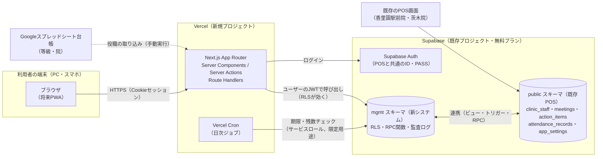
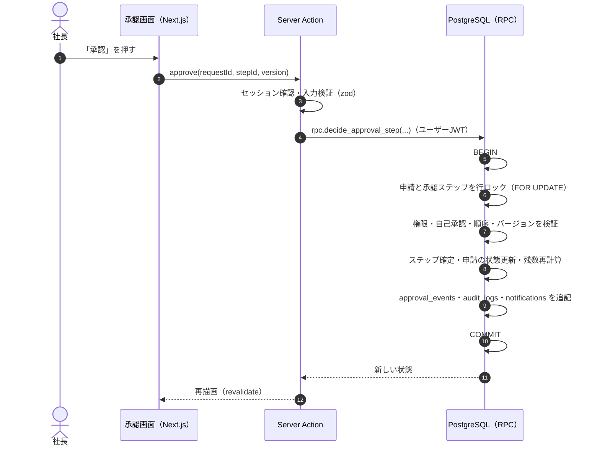

# システム構成 — AND GROUP MANAGEMENT SYSTEM

設計案 0.2（**未承認**。2026-11-05 の回答を反映）。要件は [requirements.md](./requirements.md)。

## 1. 全体構成



| 層 | 採用技術 | 役割 |
|---|---|---|
| 画面 | Next.js App Router / TypeScript / Tailwind CSS / shadcn/ui | 日本語UI、PC・スマホ対応 |
| サーバー処理 | Server Actions・Route Handlers | 入力検証（zod）、認証・権限の再確認、RPC呼び出し |
| 業務ルールの最終防衛線 | PostgreSQL の RPC 関数（plpgsql）＋ RLS | 承認順序・自己承認禁止・残数計算・排他制御をDBで強制 |
| 認証 | Supabase Auth | 個人アカウント（方式は Q-7） |
| 定期処理 | Vercel Cron（日次） | 議事録期限・有給期限・年5日の通知、取得予定→取得済みの反映 |
| ホスティング | Vercel Hobby（無料。Q-26 決定） | 本番・プレビュー環境 |

### 設計の基本方針

1. **ルールはデータベースで守る。** 画面やサーバー処理のチェックは使いやすさのため。承認順序・自己承認禁止・残数の整合性は、RLS と RPC 関数（トランザクション内）で必ず強制する。画面を経由しない操作でもルールを破れない。
2. **ユーザー本人の権限で動かす。** 通常の操作はログインユーザーのJWTでSupabaseに接続し、RLSを効かせる。サービスロールキー（RLSを無視できる鍵）は、日次ジョブとCSV取り込みの検証済み処理だけで使い、画面には出さない。
3. **残数は履歴から計算する。** 残数を直接書き換えず、付与・取得・調整の記録から算出する（[leave-management.md](./leave-management.md)）。
4. **すべての重要操作を監査ログに残す。** 監査ログは追記のみ（更新・削除不可）。
5. **店舗はデータ。** 店舗・エリア・役職・休暇区分・規定はマスタで、コード変更なしに増やせる。

## 2. 既存システムとの連携（Q-15「連携する」）

**新しいSupabaseプロジェクトは作らず、既存プロジェクトに専用スキーマ `mgmt` を追加**します。既存のテーブル名（`meetings`・`action_items`・`staff_leave_balance` など）と衝突させず、権限（RLS）も新システム側で厳しく管理するためです。

| 既存 | 現状（2026-11-05 確認） | 連携方法 |
|---|---|---|
| Supabase Auth | POSは「ID → ID@ando.jp」＋PASSでログイン | **同じ仕組みを使う**。新システムの管理画面でID・PASSを発行（Q-7）。POSと同じID・PASSで両方に入れる |
| `public.clinic_staff`（11名） | スタッフ・役割・`auth_uid`・`store_ids`・`hire_date` | `mgmt.users.pos_staff_id` で1対1に紐づけ。新しく発行したスタッフは両方に登録 |
| `public.stores`（2院：香里園駅前院・茨木院） | POSの店舗 | `mgmt.stores.pos_store_id` で紐づけ。7院の店舗マスタは `mgmt.stores` が持つ（Q-24・Q-27） |
| `public.meetings`・`public.action_items`・`public.agenda_items` | POSの院内会議・行動計画（会議2件・タスク8件） | **拡張して共用**。POSのテーブルに不足項目の列を追加し、議事録・参加者は `mgmt` 側の表で持つ（database.md §4.3） |
| `public.attendance_records` | POSの打刻（出勤・退勤・休憩） | 勤務実績の参照元（振休→勤務変更・アルバイト勤務の実績確認）。読み取りのみ |
| `app_settings` の `shifts_YYYY-MM`・`holiday_balance` | POSのシフト表と、有休残・振替残・祝振替残（JSON） | 初期残数の参考データとして読み取り。移行後は**残数の正を新システムに一本化**し、POSのシフト表には承認済みの休暇を表示、承認のない有休・振替・祝振替は警告＋「未申請」通知（Q-25 決定） |
| `public.staff_leave_balance`（0件） | 未使用の残数表 | 使わない（`mgmt` の台帳に一本化） |
| Googleスプレッドシート台帳 | 等級（G4院長・G5 BM・G6 GM）・所属院 | 役職・所属の**取り込み**（管理画面から手動実行、差分を確認してから反映） |
| /manual（行動マニュアル） | 行動基準 | 社内規定とは別物として並存。規定画面から行動マニュアルへリンク |

### 配置

```
ando-seikotsu-ibaraki/
├─ docs/                  … 本設計書（.vercelignore で既存サイトに公開しない）
├─ management/            … 新システム（Next.js）。Vercel の別プロジェクト（Root Directory に指定）
│  ├─ app/  components/  lib/  server/
│  ├─ supabase/
│  │  ├─ migrations/      … mgmt スキーマ・RLS・RPC、public への列追加（SQL）
│  │  ├─ seed/            … 店舗7院・役職・初期規定（下書き）
│  │  └─ tests/           … pgTAP
│  └─ e2e/
└─ （既存のファイル。POSのシフト画面は Q-25 のとおり一部改修：承認済み休暇の表示・未申請の警告）
```

### 既存プロジェクトを共用するときの注意

- 既存の公開ページには anon キーが埋め込まれているため、`mgmt` スキーマのすべてのテーブルで RLS を有効にし、**anon ロールには一切の権限を与えない**（`authenticated` のみ）。
- `public` への変更（列の追加）は既存のPOSが動き続けることを確認してから行う。列は追加のみ（既存の列の削除・名前変更はしない）。
- 既存のRLS無効テーブル（`patient_karte`）は本件とは別に対応を推奨（open-questions.md）。

## 3. 画面とサーバー処理の流れ



- 同時に2人が承認しても、行ロックとバージョン番号で片方だけが成功し、もう片方には「すでに処理されています」と表示する。
- 同じボタンの二度押しは、冪等キー（`idempotency_key`）で1回分だけ処理する。

## 4. 日付と時刻

| 種類 | 保存型 | 例 |
|---|---|---|
| 出来事の時刻（申請・承認・提出の日時） | `timestamptz`（UTCで保存） | 承認日時、議事録提出日時 |
| 暦の日付（休暇日・会議日・付与日・期限日） | `date` | 有給取得日、会議開催日 |
| 期限の時刻 | `timestamptz` | 議事録提出期限 |

- 表示はすべて `Asia/Tokyo`。サーバーでもタイムゾーンを明示して計算し、端末の時計設定に依存しない。
- **議事録期限** ＝ 開催日（date）＋3日 の 23:59:59 JST。例：2026-11-05 開催 → 2026-11-08 23:59:59 JST（＝ 2026-11-08 14:59:59 UTC）。DB関数 `minutes_due_at(meeting_date)` で一元計算し、テストで固定する。
- 判定は「提出日時 ≤ 期限」なら期限内（23:59:59.999… まで期限内として扱う。実装は「期限日の翌日 0:00 JST 未満」で比較）。
- 祝日は `holidays` テーブルで管理（内閣府の祝日CSVを年1回取り込み）。暦日計算（議事録期限）には使わないが、繁忙時間帯（土日祝）の判定やカレンダー表示に使う。

## 5. 定期処理（Vercel Cron）

| ジョブ | 頻度（案） | 内容 |
|---|---|---|
| minutes-reminder | 毎日 9:00 JST | 期限前日・当日の未提出会議に通知、期限超過になった会議を「期限超過」へ |
| leave-daily | 毎日 0:30 JST | 取得日を過ぎた「取得予定」を「取得済み」へ反映（取消・変更は院長が後から修正可） |
| leave-expiry | 毎日 0:30 JST | 有効期限を過ぎた付与を失効処理、期限接近（例：60日前）を通知 |
| annual-5days | 毎週月曜 | 年5日取得義務の未達見込みを判定し通知 |

- 通知はイベントキーで一意にし、ジョブが2回動いても重複しない。
- Vercel Hobby の Cron は1日1回までで、実行時刻に幅がある。上の頻度（毎日1回・週1回）はこの範囲に収めている。

## 6. 認証とセッション（Q-7：このシステムでID・PASSを発行）

- POSと同じく「ログインID（例：`tanaka`）→ Supabase Auth 上は `tanaka@ando.jp`」＋PASS。
- **PASSの発行・再発行**は管理画面から（Supabase Auth の管理APIをサーバー側で呼ぶ。初期は社長が実行。院長に自院分を許すかは Q-18）。発行したPASSは画面に1回だけ表示し、システムには保存しない。初回ログイン時に変更を求める。
- `public.clinic_staff.password` 列は使わない（PASSは Supabase Auth のみが保持）。
- セッションは `@supabase/ssr` の Cookie。Server Components・Server Actions で毎回ユーザーを確認する。
- 退職処理：`mgmt.users.status = 'retired'` にし、Supabase Auth のユーザーを停止（POSにも入れなくなる）。データは保持。

## 7. 環境

| 環境 | 用途 | データ |
|---|---|---|
| ローカル | 開発・テスト | Supabase CLI のローカルDB、ダミーデータ |
| プレビュー（Vercel Preview） | 確認用 | ダミーデータのみ。無料枠のため、検証用は既存プロジェクト内の別スキーマ（`mgmt_test`）か、一時停止中のプロジェクトの再利用で用意（Q-26） |
| 本番 | 運用 | **承認後にのみ作成・実データ登録** |

- マイグレーションはSQLファイルで管理し、ローカル → 検証 → 本番の順に適用する。
- 秘密情報（サービスロールキー等）は Vercel の環境変数にのみ置き、リポジトリやブラウザに出さない。

## 8. 無料プランでの運用とバックアップ（Q-23・Q-26）

| 項目 | 無料プランの状況 | 対応（案） |
|---|---|---|
| Supabase | 既存プロジェクト（無料）を共用。DB 500MB まで。**自動バックアップなし** | 週1回、`mgmt` スキーマと連携テーブルをエクスポートし暗号化して保管（保存先の案：会社のGoogleドライブ。Q-28） |
| Vercel Hobby | **個人・非商用の利用が前提の規約**。Cron は1日1回・時刻に幅あり | **無料で運用（Q-26 決定）**。規約上のリスクは了承済み。Cron は1日1回の範囲で設計 |
| 定期処理 | 1日1回のCronで足りる設計（§5） | 期限通知は「前日・当日の朝」に1回ずつ |

**復旧手順**：①影響範囲の特定（監査ログ）②検証環境へ復元して確認 ③本番へ復元 ④全員分の残数を再計算し、整合性チェックを確認。導入前（PHASE 10）に1回、検証環境で復旧訓練を行う。

## 9. 将来の拡張

- PWA（ホーム画面追加・プッシュ通知）
- LINE通知
- 勤怠・シフトシステムとの連携（Q-4）
- 店舗の追加（マスタ登録のみ）
