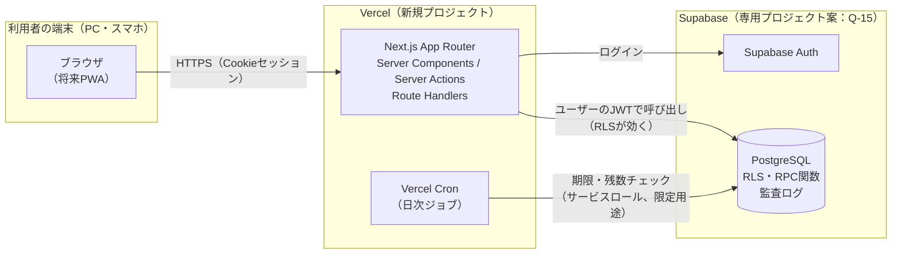
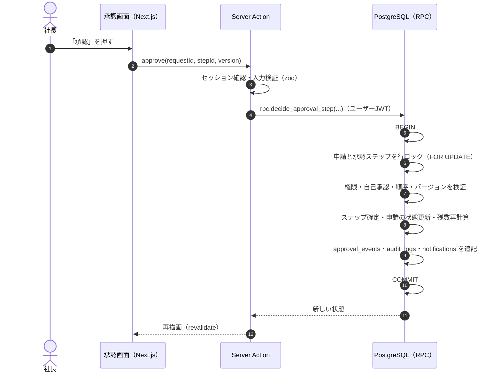

# システム構成 — AND GROUP MANAGEMENT SYSTEM

設計案 0.1（**未承認**）。要件は [requirements.md](./requirements.md)。

## 1. 全体構成



| 層 | 採用技術 | 役割 |
|---|---|---|
| 画面 | Next.js App Router / TypeScript / Tailwind CSS / shadcn/ui | 日本語UI、PC・スマホ対応 |
| サーバー処理 | Server Actions・Route Handlers | 入力検証（zod）、認証・権限の再確認、RPC呼び出し |
| 業務ルールの最終防衛線 | PostgreSQL の RPC 関数（plpgsql）＋ RLS | 承認順序・自己承認禁止・残数計算・排他制御をDBで強制 |
| 認証 | Supabase Auth | 個人アカウント（方式は Q-7） |
| 定期処理 | Vercel Cron（日次） | 議事録期限・有給期限・年5日の通知、取得予定→取得済みの反映 |
| ホスティング | Vercel | 本番・プレビュー環境 |

### 設計の基本方針

1. **ルールはデータベースで守る。** 画面やサーバー処理のチェックは使いやすさのため。承認順序・自己承認禁止・残数の整合性は、RLS と RPC 関数（トランザクション内）で必ず強制する。画面を経由しない操作でもルールを破れない。
2. **ユーザー本人の権限で動かす。** 通常の操作はログインユーザーのJWTでSupabaseに接続し、RLSを効かせる。サービスロールキー（RLSを無視できる鍵）は、日次ジョブとCSV取り込みの検証済み処理だけで使い、画面には出さない。
3. **残数は履歴から計算する。** 残数を直接書き換えず、付与・取得・調整の記録から算出する（[leave-management.md](./leave-management.md)）。
4. **すべての重要操作を監査ログに残す。** 監査ログは追記のみ（更新・削除不可）。
5. **店舗はデータ。** 店舗・エリア・役職・休暇区分・規定はマスタで、コード変更なしに増やせる。

## 2. 既存システムとの関係

このリポジトリには既存の仕組みがあります。新システムとの関係は以下の案です（**確定は Q-15**）。

| 既存 | 現状 | 新システムとの関係（案） |
|---|---|---|
| 静的HTML＋`/api`（Vercel関数） | 予約・POS・評価（/incentive）・マニュアル（/manual）など | 触らない。新システムは別ディレクトリ・別Vercelプロジェクト |
| Supabase（既存プロジェクト） | 予約などで使用。公開ページにanonキーが埋め込まれている。`clinic_staff` でスタッフ管理 | **新システムは専用のSupabaseプロジェクトを推奨**（休暇・個人情報を、公開ページと同じプロジェクトに置かないため） |
| Googleスプレッドシート（台帳） | 等級・評価・インセンティブ・マニュアル | 連携しない（初期）。等級や院の情報を将来つなぐかは Q-15 |
| /manual の行動マニュアル | スタッフの行動基準 | 社内規定（company_rules）とは別物として並存。将来の統合は Q-15 |
| `body-check/`（Next.js） | 別アプリ | 同じ構成（別ディレクトリ＋別Vercelプロジェクト）の前例として踏襲 |

### 配置（案）

```
ando-seikotsu-ibaraki/
├─ docs/                  … 本設計書（.vercelignore で既存サイトに公開しない）
├─ management/            … 新システム（Next.js）。Vercel の Root Directory に指定
│  ├─ app/                … 画面（App Router）
│  ├─ components/         … shadcn/ui ベースの部品
│  ├─ lib/                … 日付・残数計算・権限チェック（純粋関数＋テスト）
│  ├─ server/             … Server Actions・データ取得
│  ├─ supabase/
│  │  ├─ migrations/      … テーブル・RLS・RPC（SQL）
│  │  ├─ seed/            … 店舗・役職・初期規定（下書き）
│  │  └─ tests/           … pgTAP（RLS・承認ルール）
│  └─ e2e/                … Playwright
└─ （既存のファイルはそのまま）
```

> 既存サイトは、リポジトリ内のファイルがそのまま公開される構成のため、`docs/` を `.vercelignore` に追加済みです。

## 3. 画面とサーバー処理の流れ



- 同時に2人が承認しても、行ロックとバージョン番号で片方だけが成功し、もう片方には「すでに処理されています」と表示する。
- 同じボタンの二度押しは、冪等キー（`idempotency_key`）で1回分だけ処理する。

## 4. 日付と時刻

| 種類 | 保存型 | 例 |
|---|---|---|
| 出来事の時刻（申請・承認・提出の日時） | `timestamptz`（UTCで保存） | 承認日時、議事録提出日時 |
| 暦の日付（休暇日・会議日・付与日・期限日） | `date` | 有給取得日、会議開催日 |
| 期限の時刻 | `timestamptz` | 議事録提出期限 |

- 表示はすべて `Asia/Tokyo`。サーバーでもタイムゾーンを明示して計算し、端末の時計設定に依存しない。
- **議事録期限** ＝ 開催日（date）＋3日 の 23:59:59 JST。例：2026-11-05 開催 → 2026-11-08 23:59:59 JST（＝ 2026-11-08 14:59:59 UTC）。DB関数 `minutes_due_at(meeting_date)` で一元計算し、テストで固定する。
- 判定は「提出日時 ≤ 期限」なら期限内（23:59:59.999… まで期限内として扱う。実装は「期限日の翌日 0:00 JST 未満」で比較）。
- 祝日は `holidays` テーブルで管理（内閣府の祝日CSVを年1回取り込み）。暦日計算（議事録期限）には使わないが、繁忙時間帯（土日祝）の判定やカレンダー表示に使う。

## 5. 定期処理（Vercel Cron）

| ジョブ | 頻度（案） | 内容 |
|---|---|---|
| minutes-reminder | 毎日 9:00 JST | 期限前日・当日の未提出会議に通知、期限超過になった会議を「期限超過」へ |
| leave-daily | 毎日 0:30 JST | 取得日を過ぎた「取得予定」を「取得済み」へ反映（取消・変更は院長が後から修正可） |
| leave-expiry | 毎日 0:30 JST | 有効期限を過ぎた付与を失効処理、期限接近（例：60日前）を通知 |
| annual-5days | 毎週月曜 | 年5日取得義務の未達見込みを判定し通知 |

- 通知はイベントキーで一意にし、ジョブが2回動いても重複しない。
- 現在の Vercel プランによっては Cron の回数・時刻精度に制限がある。プランの確認は Q-23。

## 6. 認証とセッション

- Supabase Auth（`@supabase/ssr`）で Cookie セッションを使い、Server Components・Server Actions で毎回ユーザーを確認する。
- ログイン方式（メール＋パスワード／メールのリンク／スタッフIDとパスワード 等）は未確定（Q-7）。メールを持たないスタッフへの対応が論点。
- 退職処理：`users.status = 'retired'` にし、Supabase Auth のユーザーを停止（ban）。データは保持し、閲覧権限のある人は履歴を見られる。

## 7. 環境

| 環境 | 用途 | データ |
|---|---|---|
| ローカル | 開発・テスト | Supabase CLI のローカルDB、ダミーデータ |
| プレビュー（Vercel Preview） | 確認用 | 検証用Supabaseプロジェクト、ダミーデータのみ |
| 本番 | 運用 | **承認後にのみ作成・実データ登録** |

- マイグレーションはSQLファイルで管理し、ローカル → 検証 → 本番の順に適用する。
- 秘密情報（サービスロールキー等）は Vercel の環境変数にのみ置き、リポジトリやブラウザに出さない。

## 8. バックアップ・復旧

| 項目 | 方針（案） |
|---|---|
| 自動バックアップ | Supabase の日次バックアップ（プランにより保持日数が異なる：Q-23） |
| 追加バックアップ | 週1回、主要テーブルを暗号化した保管場所へエクスポート（保管先は要決定） |
| 復旧手順 | ①影響範囲の特定（監査ログ）②検証環境へ復元して確認 ③本番へ復元 ④残数の再計算関数を全員分実行し、整合性チェックを確認 |
| 復旧訓練 | 導入前（PHASE 10）に1回、検証環境で実施 |

## 9. 将来の拡張

- PWA（ホーム画面追加・プッシュ通知）
- LINE通知
- 勤怠・シフトシステムとの連携（Q-4）
- 店舗の追加（マスタ登録のみ）
