# データベース設計 — AND GROUP MANAGEMENT SYSTEM

設計案 0.2（**未承認**。2026-11-05 の回答を反映）。PostgreSQL（Supabase・既存プロジェクト）。権限は [permissions.md](./permissions.md)、残数計算は [leave-management.md](./leave-management.md)。

## 1. 方針

- **既存のSupabaseプロジェクトに専用スキーマ `mgmt` を作り、新システムのテーブルはすべて `mgmt` に置く。** 既存POSのテーブル（`public`）とは、紐づけ列・ビュー・RPCで連携する。
- 会議・決定事項だけは、POSと共用するため **`public.meetings`・`public.action_items` に列を追加**して使う（追加のみ。既存の列は変えない）。

- 主キーは `uuid`（`gen_random_uuid()`）。`users.id` は Supabase Auth の `auth.users.id` と同じ値。
- 時刻は `timestamptz`（UTC保存）、暦日は `date`。
- 更新される業務テーブルには `version int`（楽観ロック）、`created_at`・`updated_at`・`created_by`・`updated_by` を持たせる。
- 状態は `text` ＋ `CHECK` 制約（またはenum）で取りうる値を固定する。
- 削除は原則しない（論理削除・状態変更）。監査ログは追記のみ。
- **指示書の必須26テーブル**に加え、設計上必要な補助テーブル（★）を追加する。

## 2. テーブル一覧

| 分類 | テーブル | 内容 |
|---|---|---|
| 組織 | `users` | スタッフ（Auth と1対1） |
| | `stores` | 店舗（7院→拡張可） |
| | ★`areas` | エリア（BMの担当範囲） |
| | `user_store_assignments` | 店舗への所属と店舗内の役職（複数所属可） |
| 権限 | `roles` | 役職（社長／GM／BM／院長／一般スタッフ／アルバイト） |
| | `permissions` | 権限（操作の種類） |
| | ★`role_permissions` | 役職と権限の対応 |
| | `user_roles` | 全社・エリア単位の役職（社長・GM・BM） |
| 規定 | `company_rules` | 規定（番号・名前） |
| | `company_rule_versions` | 規定の版（本文・施行日・承認・公開状態） |
| | `rule_acknowledgements` | 既読・確認の記録（版ごと） |
| 会議 | `meetings` | 会議（**POSの `public.meetings` を拡張して共用**） |
| | `meeting_minutes` | 議事録 |
| | `meeting_attendees` | 参加者 |
| | `meeting_action_items` | 決定事項（**POSの `public.action_items` を拡張**。`mgmt` にはビューを置く） |
| | ★`tasks` | 院のタスク（POSの `action_items` で足りなければ追加） |
| 勤務 | `part_time_requests` | アルバイト勤務申請 |
| | `holiday_change_requests` | 振休からアルバイト勤務への変更申請 |
| | ★`work_records` | 実際の勤務実績（申請状態と独立） |
| 休暇 | `leave_types` | 休暇区分（有給・振休・代休） |
| | `leave_policies` | 区分ごとの制度設定（半日・時間単位・期限など） |
| | `leave_grants` | 付与（付与日単位） |
| | `leave_requests` | 休暇申請 |
| | `leave_usage` | 取得（予定・実績）と、どの付与から使ったか |
| | `leave_adjustments` | 管理者による修正（理由必須） |
| | `leave_balances` | 残数の集計キャッシュ（再計算で作る） |
| 承認 | `approval_steps` | 申請ごとの承認ステップ |
| | `approval_events` | 承認操作の履歴（追記のみ） |
| 共通 | `notifications` | アプリ内通知 |
| | `audit_logs` | 監査ログ（追記のみ） |
| | ★`holidays` | 祝日 |
| | ★`import_batches` / ★`import_rows` | CSV取り込みの単位と行ごとの検証結果 |
| | ★`approval_route_rules` | 承認者の設定（院長本人の振休は本人承認可、など） |

## 3. ER図

```mermaid
erDiagram
  users ||--o{ user_store_assignments : "所属"
  stores ||--o{ user_store_assignments : ""
  roles ||--o{ user_store_assignments : "店舗内の役職"
  users ||--o{ user_roles : "全社・エリアの役職"
  roles ||--o{ user_roles : ""
  areas ||--o{ user_roles : "BMの担当"
  areas ||--o{ stores : ""
  roles ||--o{ role_permissions : ""
  permissions ||--o{ role_permissions : ""

  company_rules ||--o{ company_rule_versions : "版"
  company_rule_versions ||--o{ rule_acknowledgements : "既読"
  users ||--o{ rule_acknowledgements : ""

  stores ||--o{ meetings : ""
  meetings ||--o| meeting_minutes : "議事録"
  meetings ||--o{ meeting_attendees : ""
  meetings ||--o{ meeting_action_items : "決定事項"
  meeting_action_items ||--o| tasks : "タスク化"
  stores ||--o{ tasks : ""

  stores ||--o{ part_time_requests : ""
  stores ||--o{ holiday_change_requests : ""
  holiday_change_requests ||--o{ work_records : "実績"
  part_time_requests ||--o{ work_records : "実績"

  leave_types ||--o{ leave_policies : ""
  users ||--o{ leave_grants : ""
  leave_types ||--o{ leave_grants : ""
  users ||--o{ leave_requests : ""
  leave_requests ||--o{ leave_usage : "日ごとの取得"
  leave_grants ||--o{ leave_usage : "どの付与から"
  users ||--o{ leave_adjustments : ""
  leave_grants ||--o{ leave_adjustments : ""
  users ||--o{ leave_balances : ""

  leave_requests ||--o{ approval_steps : ""
  part_time_requests ||--o{ approval_steps : ""
  holiday_change_requests ||--o{ approval_steps : ""
  company_rule_versions ||--o{ approval_steps : ""
  approval_steps ||--o{ approval_events : "操作履歴"

  users ||--o{ notifications : ""
  users ||--o{ audit_logs : "操作者"
  import_batches ||--o{ import_rows : ""
  import_batches ||--o{ leave_grants : "移行残高"
```

## 4. テーブル定義

> 型の略：`uuid`・`text`・`int`・`numeric`・`bool`・`date`・`time`・`tstz`(=timestamptz)・`jsonb`。共通列（`id`・`created_at`・`updated_at`・`created_by`・`updated_by`・`version`）は省略。

### 4.1 組織・権限

**users**
| 列 | 型 | 説明 |
|---|---|---|
| id | uuid | = auth.users.id（POSと共通のログイン） |
| staff_code | text UNIQUE | スタッフID（CSVのキー） |
| login_id | text UNIQUE | ログインID（Auth上は `login_id@ando.jp`） |
| pos_staff_id | int NULL | POSの `public.clinic_staff.id`（紐づけ） |
| name / name_kana | text | 氏名 |
| employment_type | text | 正社員／短時間正社員／アルバイト（区分は要確認） |
| hire_date | date | 入社日（有給の付与計算に使用） |
| weekly_work_days / weekly_work_hours | numeric | 比例付与の判定用（Q-10） |
| status | text | active／suspended／retired |
| retired_at | date | 退職日 |

**stores**：`code` UNIQUE、`name`、`area_id`、`display_order`、`is_active`、`opened_on`、`pos_store_id`（POSの `public.stores.id`。POSに登録のある院だけ）
**areas**：`name`、`display_order`

**user_store_assignments**（複数店舗所属に対応）
| 列 | 型 | 説明 |
|---|---|---|
| user_id / store_id / role_id | uuid | 店舗内の役職（院長・一般スタッフ・アルバイト） |
| is_primary | bool | 主所属（振休の承認院などの既定値） |
| starts_on / ends_on | date | 異動の履歴を残す |

制約：同じ人・同じ店舗・期間重複の禁止（`EXCLUDE USING gist`）。1店舗に有効な院長は原則1名（複数院長を許すかは運用確認）。

**user_roles**（全社・エリアの役職）：`user_id`、`role_id`（社長／GM／BM）、`area_id`（BMのみ）、`starts_on`、`ends_on`
**roles**：`code`（PRESIDENT／GM／BM／MANAGER／STAFF／PART_TIMER）、`name`、`rank`
**permissions**：`code`（例：`leave.paid.final_approve`）、`description`
**role_permissions**：`role_id`、`permission_id`

### 4.2 社内規定

**company_rules**：`rule_no`（'001'…）UNIQUE、`title`、`current_version_id`
**company_rule_versions**
| 列 | 型 | 説明 |
|---|---|---|
| rule_id | uuid | |
| version_no | int | 1,2,3…（rule_id と組で UNIQUE） |
| body | text | 本文（Markdown） |
| applies_to | jsonb | 適用対象（役職・店舗・雇用区分） |
| effective_date | date | 施行日 |
| status | text | draft／pending_approval／approved／published／superseded |
| is_provisional | bool | 初期案（労務確認前）。true の間は「施行済み」と表示しない |
| change_summary | text | 改定内容 |
| approved_by / approved_at | uuid / tstz | 社長承認 |
| published_at | tstz | |

**rule_acknowledgements**：`version_id`、`user_id`、`acknowledged_at` — `(version_id, user_id)` UNIQUE

### 4.3 会議・タスク（POSと共用）

POSの `public.meetings`（院内会議）と `public.action_items`（行動計画・タスク）を拡張して使う。POSの画面はそのまま動き、新システムからは同じ会議・タスクが見える。

**public.meetings への追加列**（既存：`id`・`held_on`・`title`・`notes`・`store_id`・`created_by`・`photos`）
| 追加列 | 型 | 説明 |
|---|---|---|
| mgmt_store_id | uuid NULL | 7院の店舗（`mgmt.stores`）。POSに無い院の会議はこちらだけを持つ（Q-24・Q-27） |
| minutes_due_at | tstz | 開催日（`held_on`）＋3日 23:59:59 JST。開催日の登録・変更時にトリガーで設定（タイムゾーン変換は生成列にできないため） |
| minutes_status | text | scheduled／awaiting_minutes／submitted／overdue |
| minutes_submitted_at | tstz NULL | 正式提出日時 |
| minutes_submitted_late | bool | 期限超過で提出したか |
| no_decisions | bool | 「決定事項なし」を明示したか |

**mgmt.meeting_minutes**：`meeting_id`（→ public.meetings）UNIQUE、`agenda`、`content`、`submitted_by`、`submitted_at`、`revision`（提出後の修正回数。修正は監査ログに残す）
**mgmt.meeting_attendees**：`meeting_id`、`user_id`（社外・他院の人は `guest_name`）

**決定事項＝ public.action_items**（既存：`title`・`detail`・`owner_staff_id`・`due_date`・`status`・`progress`・`meeting_id`・`store_id` など）
| 追加列 | 型 | 説明 |
|---|---|---|
| is_decision | bool | 議事録の決定事項か（true のとき担当者・期限・具体的な行動が必須） |
| owner_user_id | uuid NULL | `mgmt.users` の担当者（POSの `owner_staff_id` と対応） |
| mgmt_store_id | uuid NULL | 7院の店舗 |

`mgmt.meeting_action_items` はこの2表を結ぶ**ビュー**として用意する（指示書のテーブル名を保つため）。決定事項の実行状況（`status`・`progress`）は会議の完了とは別に管理する。

**mgmt.tasks**：決定事項以外の院のタスクが必要な場合に使う（POSの `action_items` で足りるなら作らない。実装時に確認）

### 4.4 勤務

**part_time_requests**
| 列 | 型 | 説明 |
|---|---|---|
| store_id | uuid | 申請院 |
| worker_user_id | uuid NULL | 勤務する人（社外の人を含むかは Q-8） |
| category | text | plan（シフト作成前の計画）／help（急な欠員）／busy（土日祝・平日夜間） |
| work_date / start_time / end_time / break_minutes | date / time / time / int | |
| reason | text | 申請理由 |
| is_exception | bool | シフト作成後の申請（理由必須） |
| exception_reason | text | |
| status | text | draft／pending／returned／approved／rejected／cancelled |
| requested_by | uuid | 院長 |

**holiday_change_requests**
| 列 | 型 | 説明 |
|---|---|---|
| store_id | uuid | |
| target_user_id | uuid | 振休を勤務に変える人 |
| shift_holiday_date | date | 変更する振休の日 |
| shift_leave_usage_id | uuid NULL | 取得予定の振休（あれば） |
| work_date / start_time / end_time / break_minutes | | 勤務予定 |
| reason | text | |
| status | text | draft／pending_gm／pending_president／returned／approved／rejected／cancelled |
| requested_by | uuid | 院長 |

**work_records**（実績。申請の状態とは独立）：`user_id`、`store_id`、`work_date`、`start_at`、`end_at`、`break_minutes`、`kind`（part_time／holiday_work 等）、`part_time_request_id`、`holiday_change_request_id`、`recorded_by`、`note`
> 割増賃金・労働時間通算の計算は本システムの対象外。実績を正しく残し、給与計算側で法令に従って処理できるようにする（Q-8・Q-4）。

### 4.5 休暇

**leave_types**：`code`、`name`、`group`
| code | 名前 | group | 発生（Q-2） |
|---|---|---|---|
| PAID | 有給休暇 | 有給 | 入社日基準の付与（Q-12） |
| SHIFT | 振替（公休出勤） | 振替休日 | 公休日に出勤したとき |
| SHIFT_HOLIDAY | 祝振替（祝日出勤） | 振替休日 | 祝日に出勤したとき |
| COMP | 代休 | 代休 | 未確定（Q-11） |

POSのシフト表の区分（有休／振替／祝振替）と同じ。振替休日は2種類を別々に管理し、画面では「振休」として合計も表示する。
**leave_policies**（区分ごとの制度。値は会社制度の確定後に設定：Q-2・Q-3）
| 列 | 型 | 説明 |
|---|---|---|
| leave_type_id | uuid | |
| valid_from | date | 制度の適用開始日（制度変更の履歴を残す） |
| half_day_allowed | bool | 半日取得 |
| hourly_allowed | bool | 時間単位取得（労使協定が必要） |
| hourly_max_days_per_year | int | 時間単位の上限日数（法令上 年5日以内） |
| hours_per_day | numeric | 時間単位の1日換算時間 |
| validity_months | int | 有効期間（有給は法定の時効 2年＝24か月） |
| expiry_rule | text | months（付与日から◯か月）／end_of_origin_month（**振休：発生した月の末日**） |
| on_expiry | text | lapse（失効）／alert_only（**振休：失効させずアラート**） |
| grant_basis | text | 有給の付与基準：hire_date（**入社日基準**）／fixed_date（統一基準日）。`valid_from` で後から変更できる |
| consume_order | text | fifo_expiry（有効期限の早い付与から使う） |
| min_notice_days | int NULL | 申請期限の目安（強制はしない） |

**leave_grants**（付与。振休は「出勤した日」ごとに1行）
| 列 | 型 | 説明 |
|---|---|---|
| user_id / leave_type_id | uuid | |
| grant_date | date | 付与日 |
| base_date | date | 基準日（有給・年5日の管理単位） |
| expires_on | date | 有効期限（この日まで使える） |
| days | numeric(5,2) | 付与日数 |
| source | text | statutory（法定付与）／company（会社独自）／migration（移行時点の初期残高）／shift_earned（振休の発生）／comp_earned（代休の発生） |
| counts_toward_5day | bool | 年5日義務の対象となる付与（付与日数10日以上） |
| origin_work_date | date NULL | 振休・代休の元になった出勤日 |
| import_batch_id | uuid NULL | CSV移行で作った場合 |
| note | text | |

**leave_requests**（申請）
| 列 | 型 | 説明 |
|---|---|---|
| user_id | uuid | 取得する人 |
| store_id | uuid | 承認の基準になる院（主所属） |
| leave_type_id | uuid | |
| start_date / end_date | date | |
| unit | text | full／half_am／half_pm／hourly |
| total_days / total_hours | numeric | 申請量 |
| reason | text | 任意（有給は理由を求めない設定にできる） |
| status | text | draft／pending／returned／approved／rejected／cancel_requested／cancelled |
| route | text | normal／alternate（自己承認回避の代替ルート） |
| balance_shortage | bool | 申請時点の残数不足 |
| exception_note | text | 残数不足時の例外確認の内容 |
| submitted_by | uuid | 本人または院長（代理申請） |

**leave_usage**（取得の予定・実績。申請1件の日ごと×付与ごと）
| 列 | 型 | 説明 |
|---|---|---|
| leave_request_id | uuid | |
| leave_grant_id | uuid | どの付与から使ったか |
| user_id / leave_type_id | uuid | 集計用（冗長） |
| usage_date | date | 取得日 |
| days / hours | numeric | |
| status | text | planned（承認済み取得予定）／taken（取得済み）／cancelled |
| counts_toward_5day | bool | 年5日に算入できるか（時間単位は算入しない 等） |

制約：`leave_usage.days` の合計が付与の残りを超えないことを RPC 内で検証。同じ人・同じ日・同じ区分の有効な取得の重複を禁止（部分ユニーク索引）。

**leave_adjustments**：`user_id`、`leave_type_id`、`leave_grant_id`、`delta_days`（＋/−）、`reason`（必須）、`adjusted_by`、`adjusted_at`
**leave_balances**（キャッシュ）：`user_id`、`leave_type_id`、`granted`、`taken`、`planned`、`pending`、`adjusted`、`current_balance`、`balance_after_planned`、`next_expiry_date`、`next_expiry_days`、`computed_at` — 正しい値は常に履歴から再計算できる

### 4.6 承認

**approval_steps**
| 列 | 型 | 説明 |
|---|---|---|
| leave_request_id / part_time_request_id / holiday_change_request_id / rule_version_id | uuid NULL | **どれか1つだけ**（`CHECK num_nonnulls(...) = 1`） |
| step_no | int | 1,2…（同じ申請で UNIQUE） |
| step_kind | text | manager_final／president_final／gm_review／alternate_final など |
| approver_role_code | text | 承認できる役職 |
| approver_store_id | uuid NULL | 院長承認のときの院 |
| status | text | waiting（前のステップ待ち）／pending／approved／returned／rejected／skipped |
| decided_by / decided_at / comment | | |

**approval_events**（追記のみ）
| 列 | 型 | 説明 |
|---|---|---|
| step_id | uuid NULL | |
| request_kind / request_id | text / uuid | |
| action | text | submit／approve／return／reject／resubmit／cancel／withdraw |
| actor_user_id | uuid | |
| reason | text | 差戻し・却下・取消は必須 |
| snapshot | jsonb | 承認時点の申請内容と関連残数 |
| idempotency_key | text UNIQUE | 二度押し防止 |
| occurred_at | tstz | |

### 4.7 共通

**notifications**：`user_id`、`kind`、`title`、`body`、`link`、`event_key`、`read_at` — `(user_id, event_key)` UNIQUE で重複通知を防ぐ
**audit_logs**（追記のみ）：`actor_user_id`、`action`、`table_name`、`record_id`、`before`、`after`（jsonb）、`reason`、`occurred_at`、`request_ip`
**holidays**：`date` PK、`name`
**import_batches**：`kind`（staff／leave_balance）、`file_name`、`status`（validated／imported／rolled_back／failed）、`row_count`、`error_count`、`executed_by`、`executed_at`
**import_rows**：`batch_id`、`row_no`、`raw`（jsonb）、`errors`（jsonb）

## 5. トランザクションと整合性

承認・残数の変更は、画面からテーブルを直接更新せず、**RPC関数**（1回の呼び出し＝1トランザクション）で行う。

| RPC関数 | 内容 |
|---|---|
| `submit_leave_request(...)` | 入力検証・残数チェック（不足なら例外確認フラグ）・承認ステップ生成・通知 |
| `decide_approval_step(step_id, action, reason, expected_version, idempotency_key)` | 承認・差戻し・却下（全申請共通） |
| `cancel_leave_request(request_id, reason)` | 取消（取得予定の解除・残数再計算） |
| `confirm_leave_taken(date)` | 取得日を過ぎた予定を取得済みへ（日次ジョブ） |
| `adjust_leave_balance(...)` | 管理者の修正（理由必須） |
| `submit_minutes(meeting_id, ...)` | 議事録の正式提出（必須項目・決定事項の検証、期限超過の記録） |
| `publish_rule_version(version_id)` | 社長承認済みの版を公開 |
| `recalc_leave_balance(user_id, leave_type_id)` | 残数キャッシュの再計算 |
| `import_commit(batch_id)` / `import_rollback(batch_id)` | CSV取り込み |

`decide_approval_step` の処理順：

1. `approval_steps` と申請本体を `SELECT … FOR UPDATE` で行ロック
2. `expected_version` と現在の `version` を比較（違えば「他の人が先に処理しました」）
3. `idempotency_key` が既にあれば、前回の結果を返して終了（二度押し）
4. 権限を検証：役職・店舗スコープ・**申請者本人や対象者本人ではないこと**（自己承認禁止）
5. 順序を検証：前のステップが `approved` であること（GM確認前の社長承認を拒否）
6. 差戻し・却下なら理由が空でないこと
7. ステップを確定、申請の状態を更新
8. 最終承認なら：休暇は `leave_usage(planned)` を作成（付与からの割り当て）、残数を再計算。勤務変更なら勤務区分を確定
9. `approval_events`・`audit_logs`・`notifications` を追記
10. COMMIT（途中で失敗したら全部取り消し）

- 同じ人の残数を同時に変更する処理は `pg_advisory_xact_lock(hashtext(user_id||leave_type))` で直列化し、二重減算を防ぐ。
- 「承認済みで取消された申請を再承認」など、許されない状態遷移は関数内で拒否する（状態遷移表は workflows.md）。

## 6. 主な索引

- `leave_usage (user_id, leave_type_id, usage_date) WHERE status <> 'cancelled'`（重複防止の部分ユニーク）
- `approval_steps (status, approver_role_code, approver_store_id)`（承認待ち一覧）
- `meetings (store_id, status, minutes_due_at)`
- `notifications (user_id, read_at)`
- `user_store_assignments (user_id) WHERE ends_on IS NULL`

## 7. 監査ログ

- `leave_*`・`approval_*`・`part_time_requests`・`holiday_change_requests`・`company_rule_versions`・`meeting_minutes`・`user_store_assignments`・`user_roles`・`users` の INSERT/UPDATE をトリガーで `audit_logs` に記録。
- `audit_logs`・`approval_events` は UPDATE/DELETE を権限ごと取り消し（`REVOKE`）、RLS でも更新・削除ポリシーを作らない。閲覧は社長・GM（と、自分に関係する記録の範囲）に限る。
