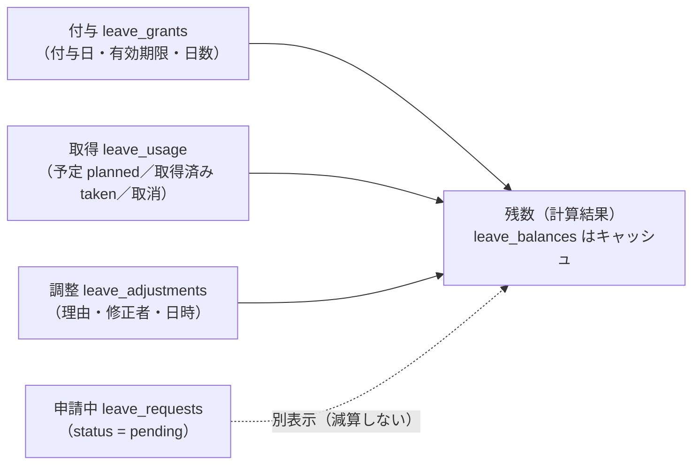
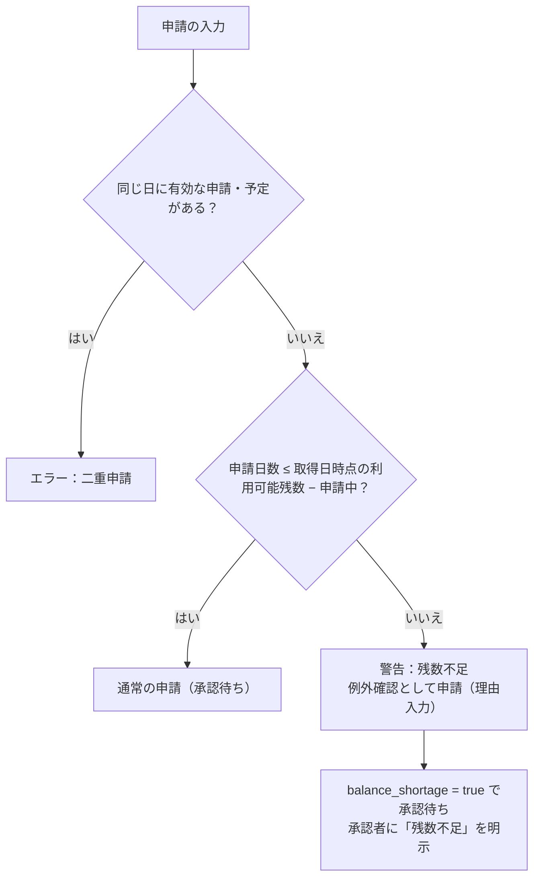
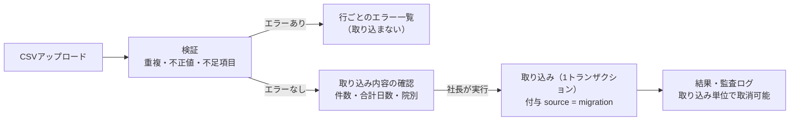

# 休暇残数管理・年5日取得管理・CSV移行 — AND GROUP MANAGEMENT SYSTEM

設計案 0.2（**未承認**。2026-11-05 の回答を反映）。テーブルは [database.md](./database.md) §4.5。

> 本書の法令に関する記述は設計のための整理です。就業規則・労使協定・運用は、社会保険労務士など労務の専門家の確認を経て確定してください（Q-2・Q-3・Q-8・Q-12）。制度の値（半日・時間単位・振休の期限など）は**設定値**として持ち、本書では決めません。

## 1. 管理する区分

| 区分 | コード | 発生 | 主な論点 |
|---|---|---|---|
| 有給休暇 | PAID | 法定付与（＋会社独自の付与があれば） | 付与日単位・時効2年・年5日義務 |
| 振替休日（振替） | SHIFT | **公休出勤**（Q-2 決定） | 原則その月のうちに取得。期限切れはアラート |
| 振替休日（祝振替） | SHIFT_HOLIDAY | **祝日出勤**（Q-2 決定） | 同上 |
| 代休 | COMP | 休日出勤のあとに与える休み | 付与条件・期限・申請フロー（Q-11） |

有給・振休・代休は**別々の残数**として管理し、合算しない。振休は POS のシフト表と同じく「振替」「祝振替」を分けて持ち、画面では合計も表示する。

## 2. 記録の仕組み（台帳方式）

残数は直接書き換えず、次の3種類の記録から毎回計算する。

- **付与**：付与日ごとに1行。有効期限を持つ。CSV移行の初期残高も「付与（source = migration）」として記録。
- **取得**：承認された申請を、日ごと・付与ごとに割り当てた行。承認時に `planned`、取得日を過ぎると `taken`、取消で `cancelled`。
- **調整**：管理者の修正。理由・修正者・日時が必須。どの付与に対する修正かを持つ。
- **申請中**：承認前の申請。残数を確定減算せず、別に表示する。

### 2.1 どの付与から使うか（割り当て）

- **有効期限の早い付与から順に使う**（前年度からの繰越分が先）。会社制度で変える場合は `leave_policies.consume_order`。
- 取得日の時点で有効な付与だけに割り当てる（取得日が期限より後になる付与には割り当てない）。
- 1回の申請が複数の付与にまたがる場合は、複数の取得行に分ける。
- 割り当ては承認時（RPC内・トランザクション内）に確定する。取消時は割り当てを解除するだけで、ほかの申請の割り当ては動かさない。

## 3. 表示する数値と計算式

基準時点 t（通常は今日）での値。区分ごと・スタッフごと。

| 表示 | 記号 | 計算 |
|---|---|---|
| 付与日数 | G | 有効な付与（`grant_date ≤ t ≤ expires_on`）の日数の合計 |
| 調整 | A | 有効な付与に対する調整の合計（＋/−） |
| 取得済み日数 | T | 有効な付与から `taken` で使った日数 |
| 承認済み取得予定日数 | P | 有効な付与から `planned` で割り当てた日数 |
| 申請中日数 | R | `pending` の申請の日数（割り当て前） |
| **現在残数** | — | **G ＋ A − T** |
| **取得予定反映後の残数（利用可能残数）** | — | **G ＋ A − T − P** |
| 申請中も反映した参考値 | — | G ＋ A − T − P − R（表示は「申請がすべて承認された場合」） |
| 有効期限 | — | 残りがある付与ごとの `expires_on` と残日数（近い順） |
| 取得履歴 | — | 取得行の一覧（日付・日数・状態・申請へのリンク） |

> 指示書の「申請中の休暇は残数から即時確定減算せず、取得予定反映後の残数として別表示」「承認済み取得予定は利用可能残数に反映」に従い、承認済み予定は利用可能残数から差し引き、申請中は別表示とする。

### 3.1 申請時のチェック

- 判定は「取得日の時点で有効な付与」で行う（取得日までに失効する分は数えない。逆に、取得日までに新しく付与される予定の分は、付与が登録済みなら数える）。
- 残数不足でも自動で却下しない。承認時に再判定し、承認後に残数がマイナスになる場合は、承認者に明示的な確認（チェック＋理由）を求める。マイナス残数を許すか（前借りの可否）は会社制度（Q-3）。

### 3.2 取消・変更

| 状況 | 処理 |
|---|---|
| 承認待ちの取下げ | 申請を `withdrawn`。申請中から外れる |
| 承認済み予定の取消 | 取得行を `cancelled`、割り当て解除、残数を再計算（同じトランザクション） |
| 取得済みの訂正（実際は出勤していた等） | 社長が理由付きで取消。取得行を `cancelled`。監査ログに記録 |
| 日付の変更 | 「取消＋新しい申請」として扱う（承認をやり直す） |
| 取消した日が既に失効した付与に割り当てられていた | 失効済みの付与には戻らない（戻した日数は失効扱い）。画面に明示 |

### 3.3 失効

- 日次ジョブで、`expires_on` を過ぎた付与の残りを「失効」として確定し、失効日数を記録する（調整ではなく失効として集計）。
- 失効の60日前（日数は要確認）に本人・院長へ通知。

## 4. 有給休暇

### 4.1 付与

- 付与日（基準日）単位で管理する。**入社日基準（Q-12 決定）**。後から統一基準日などに変更できるよう、付与基準は `leave_policies.grant_basis` に適用開始日つきで持つ（変更しても過去の付与は変えない）。
- 入社日は `mgmt.users.hire_date`（POSの `clinic_staff.hire_date` から取り込み）。
- 法定の付与日数（参考）：継続勤務6か月で10日、以後1年ごとに 11・12・14・16・18・20日（出勤率8割以上が条件）。週の所定労働日数が少ない人は比例付与（Q-10）。
- 付与は「付与予定」をシステムが計算して一覧にし、**院長・社長が確認してから確定**する（出勤率の判定など人の確認が必要なため、初期は自動付与しない案）。

### 4.2 繰越・失効

- 有給の請求権の時効は2年。付与日から2年後の前日を有効期限とする（例：2026-04-01 付与 → 2028-03-31 まで）。
- 「繰越」は新しい付与を作るのではなく、前年の付与がまだ有効で残っている状態として表示する。

### 4.3 半日・時間単位

| 単位 | 扱い | 年5日への算入 | 状態 |
|---|---|---|---|
| 全日 | 1日 | 算入する | 標準 |
| 半日（午前・午後） | 0.5日 | 算入する（0.5日） | 会社制度で導入するか未確定（Q-3） |
| 時間単位 | 1日＝所定労働時間で換算 | **算入しない** | 労使協定が必要・年5日分以内。導入するか未確定（Q-3） |

- データは日数（小数）と時間を持てる形にしておき、制度が決まったら `leave_policies` の設定で有効化する。

## 5. 年5日取得義務の管理

### 5.1 対象

- 1回の付与で**10日以上**付与される人（`leave_grants.counts_toward_5day = true`）。前年からの繰越分は10日の判定に含めない。
- 管理期間：基準日（付与日）から1年間。

### 5.2 表示項目

| 項目 | 内容 |
|---|---|
| 基準日 | 10日以上の付与の付与日 |
| 対象期間 | 基準日〜1年後の前日 |
| 必要取得日数 | 5日 |
| 取得済み日数 | 期間内に取得した有給（下の算入ルール） |
| 残り必要日数 | 5 − 取得済み（0未満は0） |
| 取得期限 | 対象期間の末日 |
| 未達見込み | 下の判定 |

### 5.3 算入ルール

| 取得の種類 | 算入 |
|---|---|
| 本人の申請による取得（全日） | する |
| 本人の申請による半日取得 | する（0.5日） |
| 時間単位の取得 | しない |
| 前年度からの繰越分を使った取得 | する（どの付与から使ったかを問わない） |
| 計画的付与・会社の時季指定による取得 | する（制度がある場合：Q-12） |
| 会社独自の特別休暇（有給とは別の休暇） | しない |
| 承認済みだが未取得の予定 | 「取得済み」には入れず、「予定込み」として別に表示 |

- 基準日が前倒しになり期間が重なる場合（いわゆる期間の重複）の特例計算は、制度確定後に対応する（Q-12）。初期は「重複なし」を前提にし、重複を検知したら警告する。

### 5.4 未達見込みの判定（案・閾値は要確認）

| レベル | 条件（案） | 通知先 |
|---|---|---|
| 注意 | 期間の残りが6か月以下 かつ（取得済み＋承認済み予定）が「経過割合×5日」を下回る | 本人・院長 |
| 警告 | 期間の残りが3か月以下 かつ（取得済み＋予定）＜5日 | 本人・院長・GM |
| 至急 | 期間の残りが1か月以下 かつ（取得済み＋予定）＜5日 | 本人・院長・GM・社長 |

- 判定は週1回のジョブと、申請・取消のたびに実行。同じレベルの通知は1回だけ（レベルが上がったら再通知）。
- 会社の時季指定の手続き（意見聴取など）はシステム外で人が行い、取得日をシステムに記録する。

### 5.5 年次有給休暇管理簿

- 法令で作成・保存が求められる年次有給休暇管理簿（時季・日数・基準日）を、本システムのデータから出力できるようにする（CSV／印刷）。保存期間の扱いは Q-17。

## 6. CSVによる初期移行

### 6.1 スタッフCSV

| 列 | 必須 | 検証 |
|---|---|---|
| スタッフID | ○ | 一意（ファイル内・既存データ） |
| 氏名 | ○ | 空でない |
| 所属店舗 | ○ | 7院のいずれか（店舗名・コードの表記ゆれを正規化して照合）。複数所属は `;` 区切り |
| 役職 | ○ | 社長／GM／BM／院長／一般スタッフ／アルバイト（所属店舗ごと） |
| 入社日 | 推奨 | 日付形式（有給の付与計算に必要） |
| メールアドレス等のログイン情報 | Q-7次第 | ログイン方式による |

### 6.2 残数CSV

| 列 | 必須 | 検証 |
|---|---|---|
| スタッフID | ○ | スタッフCSVに存在 |
| 有給残数 | ○ | 0以上の数値・0.5刻み（時間単位を使う場合は別列） |
| 振休残数 | ○ | 0以上の数値 |
| 基準日 | ○ | 日付 |
| 付与日 | ○ | 日付・基準日との整合 |
| 有効期限 | ○ | 日付・付与日より後・有給は付与日から2年以内 |

**決定（Q-5）：付与ごとに1行**で受け取る。上の列に加えて次を持つ。

| 列 | 必須 | 内容 |
|---|---|---|
| 区分 | ○ | 有給／振替／祝振替 |
| 付与日（振休は出勤日） | ○ | 付与ごとの日付 |
| 有効期限 | ○ | 付与ごとの期限（振休は出勤月の末日） |
| 残日数 | ○ | その付与の移行時点の残り |
| 当期の取得済み日数 | 有給・10日以上付与の人 | 年5日管理用（今の対象期間で移行前に取得した日数） |

- 香里園駅前院・茨木院は、POSの `holiday_balance`（有休残・振替残・祝振替残）と `clinic_staff.hire_date` から**CSVの下書きを自動作成**し、院長が確認・修正してから取り込む案（付与日・期限はPOSに無いため補う必要あり）。

### 6.3 取り込みの流れ

- 文字コードは UTF-8（BOM付き可）と Shift_JIS（Excel保存）に対応。
- 履歴が分からない残数は、**移行時点の初期残高**（`source = migration`、`note` に「移行時点の残数」）として記録し、通常の付与と区別して表示する。
- 取り込みは何度でも検証できるが、実行は1バッチ1回。取り消すと、そのバッチで作った付与を削除扱いにして残数を再計算する（取り込み後に取得が発生した付与は取消不可）。
- **本番への実データ取り込みは、承認をいただいてから行う。**

## 7. 振替休日・代休

| 項目 | 状態 |
|---|---|
| 振休が発生する条件 | **決定**：公休出勤（振替）・祝日出勤（祝振替）。院長が出勤日を登録（POSのシフト・打刻から候補を表示） |
| 振休の取得期限 | **決定**：原則、出勤した月の末日まで（`expiry_rule = end_of_origin_month`） |
| 期限を過ぎた振休の扱い | **決定**：失効させずアラート（`on_expiry = alert_only`）。残数は残し、本人・院長・GMに「期限切れ振休」として表示 |
| 半日出勤で発生する振休 | 0.5日とするか、実装前に確認 |
| 代休の発生・申請・承認フロー | 指示書に記載がないため未確定（Q-11）。区分とデータ構造だけ用意する |
| 振休をアルバイト勤務に変更した場合の振休日数 | 未確定（Q-8） |

> 振替休日（事前に休日と労働日を入れ替える）と代休（休日に働いた後で休みを与える）は、割増賃金の扱いが異なります。区分を混同しないよう、画面上も別の区分として表示します。
