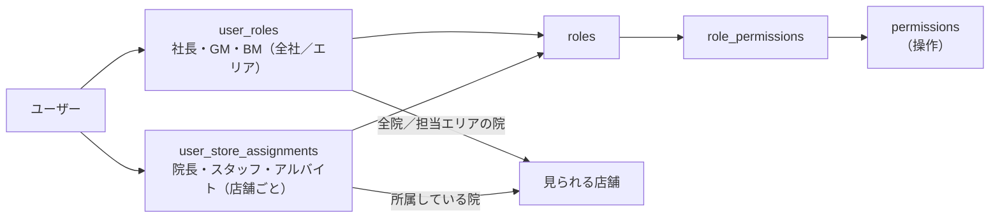

# 権限設計（RBAC・店舗スコープ・RLS） — AND GROUP MANAGEMENT SYSTEM

設計案 0.1（**未承認**）。

## 1. 考え方

権限は「**何ができるか（役職→権限）**」と「**どの範囲か（店舗スコープ）**」の掛け合わせで決める。



| スコープ | 範囲 |
|---|---|
| 全社 | 社長・GM：全店舗 |
| エリア | BM：担当エリア（`user_roles.area_id`）に属する店舗 |
| 店舗 | 院長・スタッフ・アルバイト：`user_store_assignments` で有効な店舗（院ごとに役職が違ってよい） |
| 本人 | 自分の休暇・申請・タスク・通知 |

**複数店舗所属**：店舗ごとに役職を持つ。例）A院の院長・B院の一般スタッフ の人は、A院では院長の権限、B院ではスタッフの権限だけを持つ。B院のスタッフの振休は承認できない。

## 2. 権限一覧（permissions）

| コード | 内容 |
|---|---|
| `leave.view.self` | 自分の残数・履歴を見る |
| `leave.view.store` | 店舗スタッフの残数・申請を見る |
| `leave.request.self` | 自分の休暇を申請する |
| `leave.request.proxy` | 店舗スタッフの休暇を代理で申請する（院長） |
| `leave.paid.final_approve` | 有給の最終承認 |
| `leave.shift.approve` | 振休の承認（店舗） |
| `leave.shift.alternate_approve` | 振休の代替承認（自己承認回避ルート） |
| `leave.adjust` | 残数の修正（理由必須） |
| `leave.import` | CSVでの残数取り込み |
| `parttime.request` | アルバイト勤務を申請する |
| `parttime.final_approve` | アルバイト勤務の最終承認 |
| `holidaychange.request` | 振休→アルバイト勤務の変更を申請する |
| `holidaychange.gm_review` | 振休変更の事前確認 |
| `holidaychange.final_approve` | 振休変更の最終承認 |
| `meeting.manage` | 会議・議事録の作成・提出 |
| `task.manage.store` | 店舗のタスク管理 |
| `task.view.self` | 自分のタスクを見る |
| `rule.view` | 規定を読む・確認する |
| `rule.edit` | 規定の下書き・改定案を作る |
| `rule.approve` | 規定の制定・改定を承認・公開する |
| `dashboard.gm` / `dashboard.president` / `dashboard.manager` / `dashboard.area` | 各ダッシュボード |
| `audit.view` | 承認履歴・監査ログを見る |
| `master.manage` | 店舗・ユーザー・所属・役職の管理 |

## 3. 役職×権限マトリクス

○＝できる、△＝範囲限定、－＝できない

| 権限 | 社長 | GM | BM | 院長 | 一般スタッフ | アルバイト |
|---|---|---|---|---|---|---|
| 閲覧範囲 | 全院 | 全院 | 担当エリア | 自院 | 本人 | 本人 |
| 自分の残数・履歴 | ○ | ○ | ○ | ○ | ○ | ○ |
| 店舗スタッフの残数・申請 | ○ | ○ | △エリア | △自院 | － | － |
| 有給の申請（本人） | －※1 | ○ | ○ | ○ | ○ | 未確定（Q-10） |
| **有給の最終承認** | **○** | － | － | － | － | － |
| 振休の申請（本人） | － | ○ | ○ | ○ | ○ | 未確定（Q-10） |
| **振休の承認** | 閲覧のみ | 閲覧のみ・代替承認（案：Q-1） | － | **○自院（本人以外）** | － | － |
| 残数の修正 | ○ | 未確定（Q-18） | － | － | － | － |
| CSV取り込み | ○ | 未確定（Q-18） | － | － | － | － |
| アルバイト勤務の申請 | － | － | － | ○自院 | － | － |
| **アルバイト勤務の最終承認** | **○** | － | － | － | － | － |
| 振休→勤務の変更申請 | － | － | － | ○自院 | － | － |
| **振休変更の事前確認** | － | **○** | － | － | － | － |
| **振休変更の最終承認** | **○（GM確認後のみ）** | － | － | － | － | － |
| 会議・議事録の作成・提出 | ○ | ○ | － | ○自院 | 未確定（書記を任せるか） | － |
| 店舗のタスク管理 | ○ | ○ | － | ○自院 | － | － |
| 自分のタスク確認 | ○ | ○ | ○ | ○ | ○ | ○ |
| 規定を読む・確認する | ○ | ○ | ○ | ○ | ○ | ○ |
| 規定の改定案作成 | ○ | 未確定 | － | － | － | － |
| **規定の承認・公開** | **○** | － | － | － | － | － |
| 期限超過・未完了業務の管理 | ○ | ○ | △エリア | △自院 | － | － |
| 全院KPI | ○ | ○ | △エリア | △自院 | － | － |
| 承認履歴・監査ログ | ○ | 閲覧（案） | － | － | － | － |
| マスタ管理（店舗・ユーザー） | ○ | 未確定 | － | － | － | － |

※1 社長が労働者として有給を取得する対象かは要確認。対象外として設計し、必要なら追加する。

> 指示書で役職の記載がない操作（BMの承認権限、GMの残数修正など）は「未確定」とし、勝手に権限を与えない。

## 4. 承認者の決め方

| 申請 | 通常の承認者 | 承認者を決める条件 |
|---|---|---|
| 有給 | 社長 | `user_roles` で有効な社長。申請者・対象者本人ではないこと |
| 振休 | 対象者の**承認院**の院長 | 承認院＝申請の `store_id`（既定は主所属）。その院で有効な院長で、**対象者本人ではない**こと |
| アルバイト勤務 | 社長 | |
| 振休→勤務の変更 | ①GM（事前確認）→ ②社長（最終） | ①が承認されるまで②は「待機」で操作不可 |
| 規定の制定・改定 | 社長 | 改定案の作成者が社長自身の場合の扱いは Q-1 と同様に要確認 |

### 自己承認の防止

- RPC内で「承認者 ≠ 申請者」かつ「承認者 ≠ 対象スタッフ」を必ず確認する（画面でボタンを隠すだけにしない）。
- 自己承認になる申請は、申請時に `route = 'alternate'` として**代替承認ルート**のステップを作る。

| ケース | 代替承認者（**未確定・案**） |
|---|---|
| 院長本人の振休 | GM（指示書の案。**正式運用前に会社承認が必要**：Q-1） |
| GM本人の振休 | 未確定（社長？）：Q-13 |
| BM本人の振休 | 未確定（所属院の院長？GM？）：Q-13 |
| 複数院の院長を兼ねる人の振休 | 院長本人以外の院長がいない場合は代替ルート |
| 社長不在時の有給・アルバイト勤務の承認 | 代理承認の有無は未確定（Q-6）。決まるまでは「社長のみ」 |

代替承認者は `approval_route_rules`（設定値）として持ち、会社承認後に有効化する。**未承認の間は代替ルートの申請を「代替承認者未設定」として止め、社長・GMに通知する**（勝手にGM承認で通さない）。

## 5. 承認者本人の確認

- 承認・差戻し・却下・残数修正・規定公開は、ログイン中のセッションに加え、**直近ログインから一定時間（例：12時間）以内**であることを要求し、超えていれば再ログインを求める（時間は要確認）。
- 将来、社長のアカウントには二要素認証（TOTP）を推奨。

## 6. RLS（行レベルセキュリティ）

全テーブルで RLS を有効にする。判定は以下のヘルパー関数（`security definer`、`search_path` 固定）で行う。

| 関数 | 内容 |
|---|---|
| `app.current_user_id()` | `auth.uid()`。退職・停止中なら NULL |
| `app.has_global_role(code)` | 社長・GM か |
| `app.visible_store_ids()` | 見られる店舗の一覧（全社／エリア／所属） |
| `app.store_role(store_id)` | その店舗での役職 |
| `app.can(permission, store_id)` | 権限＋スコープの判定 |

ポリシーの例：

```sql
-- 休暇申請：本人／見られる店舗の院長以上／社長・GM が閲覧できる
create policy leave_requests_select on leave_requests for select using (
  user_id = app.current_user_id()
  or app.can('leave.view.store', store_id)
);

-- 申請の作成は本人（または院長の代理申請）。状態は pending からしか作れない
create policy leave_requests_insert on leave_requests for insert with check (
  (user_id = app.current_user_id() or app.can('leave.request.proxy', store_id))
  and status in ('draft','pending')
);

-- 状態の変更（承認など）は RPC 経由のみ。テーブルへの直接 UPDATE は許可しない
-- （UPDATE ポリシーは「本人の draft の編集」だけ）
```

- 承認・残数・勤務区分の確定は、**テーブルへの直接更新を許さず RPC 関数のみ**で行う。
- `audit_logs`・`approval_events` は INSERT も RPC/トリガーからのみ（一般ユーザーは直接書き込めない）、UPDATE・DELETE は誰もできない。
- 他院のデータが混ざらないよう、店舗を持つテーブルはすべて `store_id` でポリシーを掛け、テストで7院分を相互に検証する（test-plan.md）。

## 7. サーバー側での再確認

Server Action では次の順で確認し、最後は RPC と RLS で再度強制する（三重のチェック）。

1. セッションが有効で、ユーザーが active
2. 入力値の検証（zod：日付・数値・文字数・列挙値）
3. 権限＋店舗スコープ（`can()` と同じ判定をサーバーでも実行）
4. RPC 呼び出し（DB内で権限・自己承認・順序・排他を最終判定）

## 8. 退職・異動

- 退職：`users.status = 'retired'`、Auth を停止。進行中の承認ステップの承認者だった場合は、社長・GMに「承認者不在」を通知。
- 異動：`user_store_assignments.ends_on` を設定し新しい行を追加。過去の申請は申請時の店舗のまま残る。
- 院長交代：その院の承認待ちの振休は、新院長が承認できる（承認者は役職と店舗で決まるため、人の付け替えは不要）。
