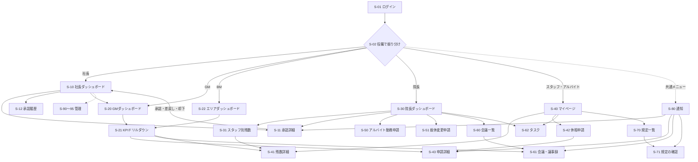

# 画面設計 — AND GROUP MANAGEMENT SYSTEM

設計案 0.1（**未承認**）。日本語UI・PC／スマホ対応（院長・スタッフはスマホ中心、社長・GMはPC＋スマホ）。

## 1. 画面一覧

| ID | 画面 | URL（案） | 主な利用者 |
|---|---|---|---|
| S-01 | ログイン | `/login` | 全員 |
| S-02 | ホーム（役職別ダッシュボードへ振り分け） | `/` | 全員 |
| S-10 | 社長ダッシュボード（承認キュー） | `/president` | 社長 |
| S-11 | 承認詳細 | `/approvals/[stepId]` | 社長・院長・GM |
| S-12 | 承認履歴 | `/approvals/history` | 社長（GM閲覧） |
| S-20 | GMダッシュボード（全院KPI） | `/gm` | GM・社長 |
| S-21 | KPIドリルダウン一覧 | `/gm/kpi/[kpi]?store=&month=&staff=` | GM・社長 |
| S-22 | エリアダッシュボード | `/area` | BM |
| S-30 | 院長ダッシュボード | `/store/[storeId]` | 院長 |
| S-31 | スタッフ別 残数一覧 | `/store/[storeId]/leave` | 院長 |
| S-40 | マイページ（残数・申請・タスク・未確認規定） | `/me` | 全員 |
| S-41 | 休暇の残数詳細（付与ごと・履歴） | `/me/leave/[type]` ・ `/staff/[userId]/leave/[type]` | 本人・院長以上 |
| S-42 | 休暇申請（有給・振休） | `/leave/new` | スタッフ・院長 |
| S-43 | 申請詳細（状態・承認の進み具合） | `/leave/[id]` | 申請者・承認者 |
| S-50 | アルバイト勤務申請 一覧・新規 | `/part-time` ・ `/part-time/new` | 院長・社長・GM |
| S-51 | 振休→アルバイト勤務 変更申請 | `/holiday-change` ・ `/holiday-change/new` | 院長・GM・社長 |
| S-52 | 勤務実績の記録 | `/work-records` | 院長（範囲は Q-4） |
| S-60 | 会議一覧・カレンダー | `/meetings` | 院長・GM |
| S-61 | 会議・議事録の作成／提出 | `/meetings/[id]` | 院長 |
| S-62 | 決定事項・タスク | `/tasks` | 院長・スタッフ |
| S-70 | 社内規定 一覧 | `/rules` | 全員 |
| S-71 | 規定の閲覧・確認（既読） | `/rules/[no]` | 全員 |
| S-72 | 規定の編集・改定案・版の比較 | `/rules/[no]/edit` | 社長（改定案作成者） |
| S-80 | 通知 | `/notifications` | 全員 |
| S-90 | 管理：店舗・エリア | `/admin/stores` | 社長 |
| S-91 | 管理：スタッフ・所属・役職 | `/admin/users` | 社長 |
| S-92 | 管理：休暇制度（leave_policies） | `/admin/leave-policies` | 社長 |
| S-93 | 管理：残数の修正 | `/admin/leave-adjustments` | 社長 |
| S-94 | 管理：CSV取り込み（検証→取り込み→取消） | `/admin/import` | 社長 |
| S-95 | 管理：監査ログ | `/admin/audit` | 社長（GM閲覧） |

## 2. 画面遷移図



## 3. 共通レイアウト

- **スマホ**：下部タブ（ホーム／申請／承認※／会議※／通知）＋右上メニュー。※権限がある人だけ表示。
- **PC**：左サイドバー＋上部に店舗切替（複数店舗所属・全院を見られる人）。
- 表示は日本時間。日付は `2026年11月8日（日）`、期限は残り時間も表示（例：「あと1日」「期限超過 2日」）。
- 状態は色＋文字の両方で表示（色だけに頼らない）：承認待ち＝黄、承認済み＝緑、差戻し＝橙、却下・期限超過＝赤。

## 4. 社長ダッシュボード（S-10）

承認業務を最優先に、上から「やること」を並べる。

```
┌────────────────────────────────────────┐
│ 承認待ち  12件      うち緊急 1件          │
├────────────────────────────────────────┤
│ [緊急] アルバイト勤務（ヘルプ） 交野院  11/6 │ → S-11
│ 有給  茨木院 山田さん 11/20 1日  残 8.0日   │ → S-11
│ 振休変更（GM確認済み） 津田院 …              │ → S-11
│ 規定 004 改定案（初期案）                    │ → S-11
├────────────────────────────────────────┤
│ タブ：有給(5) アルバイト(4) 振休変更(2) 規定(1) │
├────────────────────────────────────────┤
│ 全院の状況（S-20の要約）                     │
│ 議事録期限超過 2件 / 年5日未達見込み 3名 …    │
└────────────────────────────────────────┘
```

**承認詳細（S-11）に表示するもの**
- 申請内容・申請区分・申請理由・対象日（時間）・対象スタッフ・申請者・申請日時
- 関連残数：現在残数／承認済み予定／申請中／この申請の承認後の残数／有効期限の近い付与
- 年5日の状況（有給の場合）、例外申請・残数不足の警告
- 承認の進み具合（振休変更なら GM確認の結果とコメント）
- ボタン：承認／差戻し／却下。差戻し・却下は理由入力ダイアログ（空では押せない）。承認後は次の承認待ちへ自動で進む。

## 5. GMダッシュボード（S-20）

フィルター：店舗（7院・複数選択）／月／スタッフ。各数値はクリックで S-21 の該当一覧へ。

| KPI | 定義（案） | 遷移先 |
|---|---|---|
| 議事録提出率 | 当月の開催済み会議のうち提出済み（期限超過を含む）の割合 | 会議一覧 |
| 期限内提出率 | 当月の開催済み会議のうち期限内に提出した割合 | 会議一覧 |
| 議事録期限超過件数 | 現在「期限超過」の会議数 | 会議一覧 |
| 会議決定事項の実行率 | 期限が当月までの決定事項のうち完了の割合 | 決定事項一覧 |
| アルバイト申請件数 | 当月の申請数（区分別・例外申請の内訳つき） | 申請一覧 |
| 社長承認待ち件数 | 社長ステップが pending の件数 | 承認一覧 |
| 緊急ヘルプ申請件数 | 区分＝ヘルプの申請数（当月） | 申請一覧 |
| 有給取得率 | 期間内の取得日数 ÷ 付与日数（定義は要確認：Q-19） | スタッフ別 |
| 有給年5日未達見込み人数 | 年5日判定で「未達見込み」の人数 | スタッフ別 |
| 振替休日残数 | 全員の振休残数の合計（期限の近いもの別表示） | スタッフ別 |
| 休暇残数不足申請件数 | `balance_shortage = true` の申請数 | 申請一覧 |
| 規定未確認人数 | 公開中の最新版を未確認の人数 | 規定・確認状況 |

表示：店舗×KPI のヒートマップ表（行＝7院、列＝KPI）＋全社合計。院の行が増えても同じ表で扱える。

## 6. 院長ダッシュボード（S-30・スマホ優先）

上から順に1画面スクロールで完結。

1. **期限が近いもの**：議事録の提出期限（残り時間）、期限超過業務
2. **承認待ち**：振休の承認待ち（その場で承認・差戻し・却下）
3. **今月の会議予定**（＋会議を登録）
4. **未完了タスク**（決定事項を含む）
5. **スタッフ別 残数**：有給・振休（残数・期限の近い日数・年5日の状況アイコン）
6. **申請状況**：自院スタッフの有給申請（社長承認待ちなど）、アルバイト勤務申請・振休変更申請の状況

## 7. マイページ（S-40）

- 有給・振休・代休のカード（各カードに：現在残数／取得予定反映後の残数／申請中／次に失効する日数と日付）
- 年5日の進み具合（対象者のみ）：基準日・期間・必要日数・取得済み・残り必要日数・期限
- 自分の申請一覧（状態）、タスク、未確認の規定、通知

## 8. 休暇申請（S-42）

1. 区分（有給／振休／代休※）を選ぶ（※代休の申請フローは未確定：Q-11）
2. 日付・単位（全日／半日※／時間※）を選ぶ（※制度で許可されている場合のみ表示：Q-3）
3. 画面にその場で残数の変化を表示：「現在 8.0日 → 承認後 7.0日」
4. 残数不足のときは警告を表示し、「例外確認として申請する」に切り替え（理由入力）
5. 同じ日に申請・予定がある場合はエラー（二重申請防止）
6. 送信 → 「承認待ち」

## 9. CSV取り込み（S-94）

アップロード → 検証結果（行ごとのエラー・警告）→ 取り込み内容の確認 → 実行 → 取り込み結果（取り込み単位で取消可能）。詳細は [leave-management.md](./leave-management.md) §6。

## 10. スマホ操作の配慮

- 主要ボタンは指で押しやすい大きさ（高さ44px以上）。
- 承認・差戻し・却下は確認ダイアログを挟む（誤操作防止）。
- 一覧は無限スクロールではなくページ分割（通信量・表示速度のため）。
