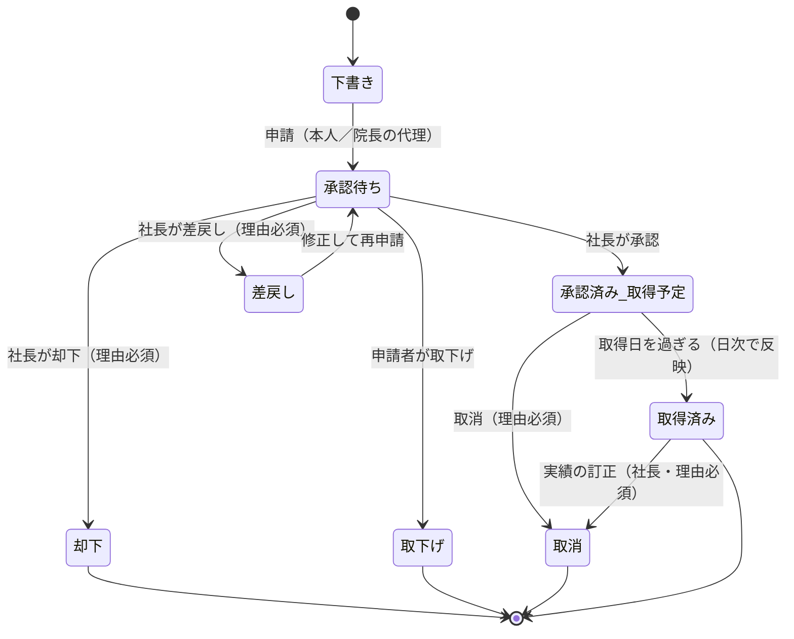
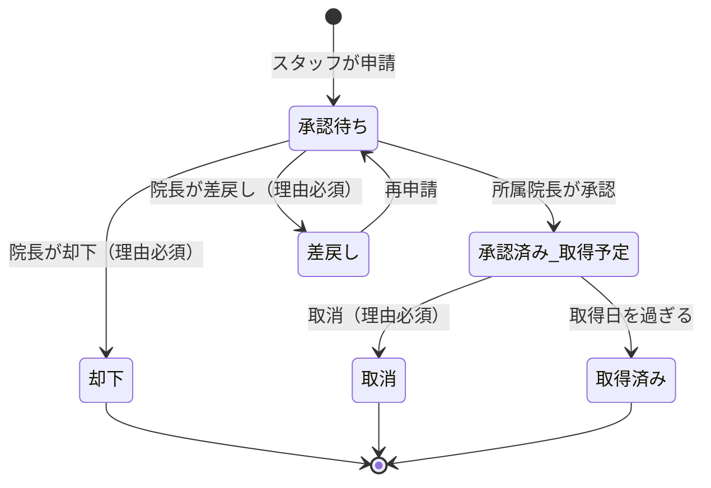
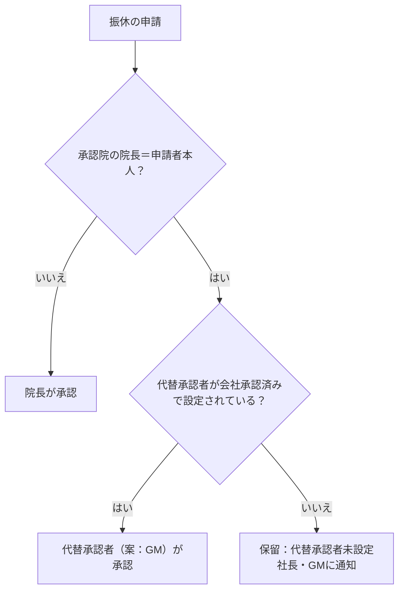
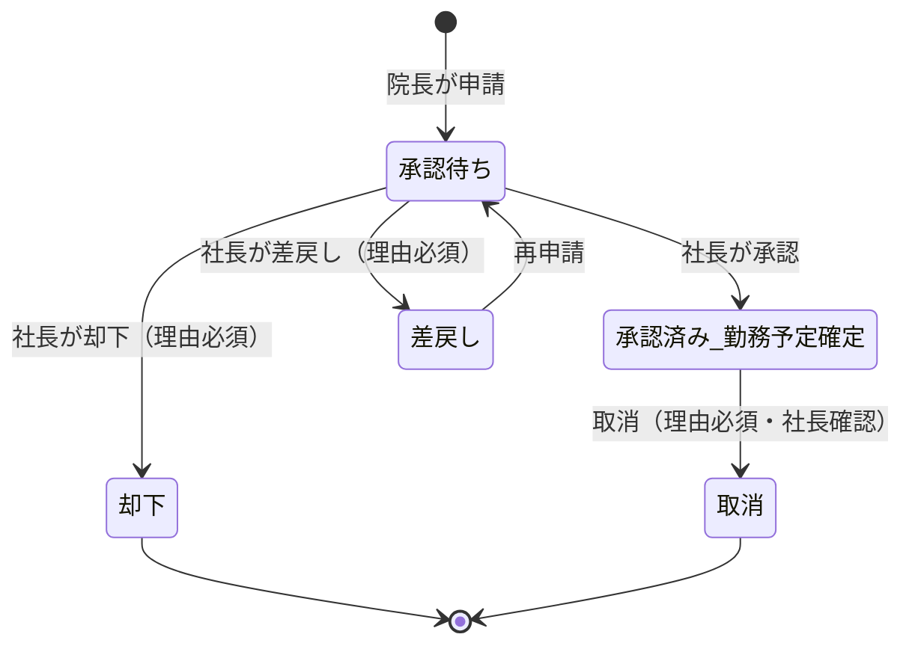
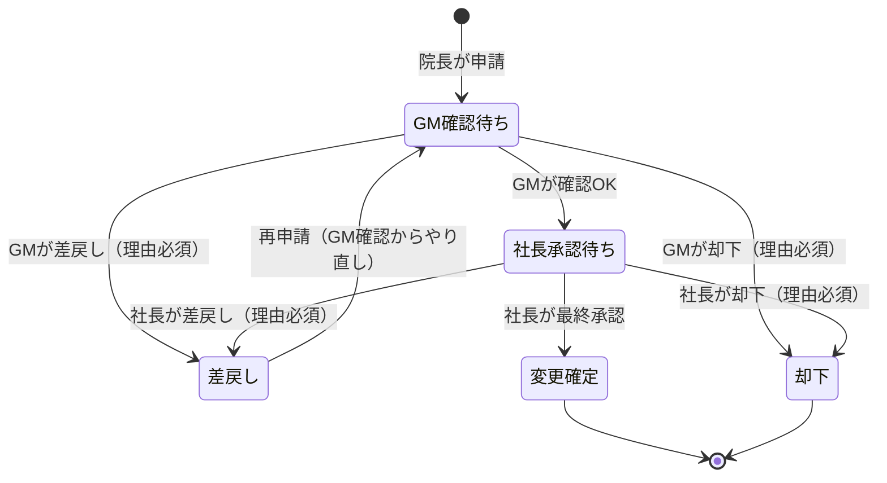
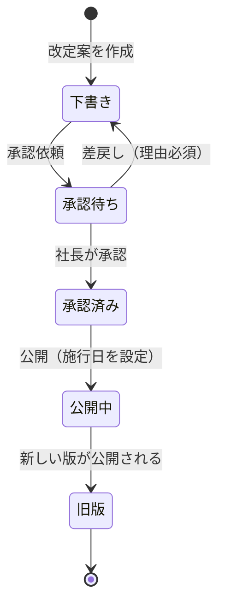
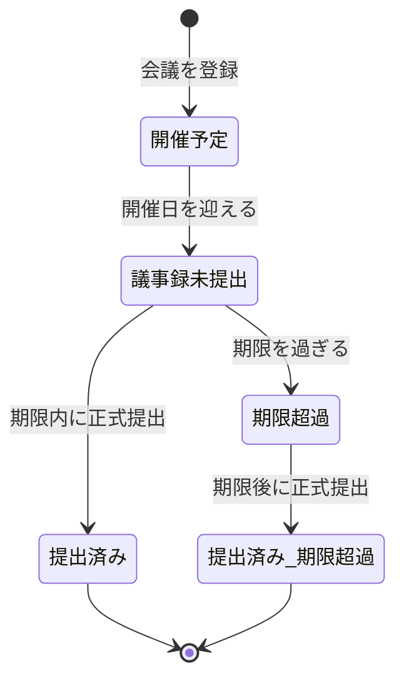

# 業務フロー・承認フロー — AND GROUP MANAGEMENT SYSTEM

設計案 0.1（**未承認**）。承認処理の実装（トランザクション）は [database.md](./database.md) §5、承認者の決め方は [permissions.md](./permissions.md) §4。

## 0. 共通ルール

| 項目 | ルール |
|---|---|
| 操作 | 承認／差戻し／却下（＋申請者の取下げ・取消） |
| 理由 | **差戻し・却下・取消は理由必須**。承認は任意コメント |
| 差戻し | 申請者が修正して再申請できる。承認ステップは最初からやり直し |
| 却下 | 確定（再申請は新しい申請として出す） |
| 承認前 | 「承認待ち」と表示。残数・勤務区分は確定しない |
| 自己承認 | できない。自己承認になる場合は代替ルート（未確定：Q-1・Q-13） |
| 履歴 | すべての操作を `approval_events`（承認時点の申請内容・関連残数のスナップショット付き）と `audit_logs` に保存 |
| 同時操作 | 行ロック＋バージョン番号。後から押した人には「すでに処理されています」と表示 |

---

## 1. 有給休暇（4-1）

| 段階 | 誰が | 残数への影響 |
|---|---|---|
| 申請 | スタッフ本人／院長（代理） | 「申請中」に加算（残数は確定減算しない） |
| 承認待ち | 社長が確認。**院長・GMは閲覧のみ** | 同上 |
| 承認 | 社長のみ | 付与から割り当てて「承認済み取得予定」へ。利用可能残数から差し引く |
| 取得済み | 取得日の翌日に自動反映（院長が実績を訂正可） | 「取得済み」へ |
| 取消 | 申請者（取得前）／社長（取得後の訂正） | 割り当てを解除して再計算 |

**法令への配慮（FR-PL-4）**
- 有給は労働者が時季を指定する権利。システムは「申請＝承認待ち」として扱い、**残数があるのに自動で却下することはしない**。
- 事業の正常な運営を妨げる場合の時季変更は、社長（人）が判断し、理由を記録する。画面上の「却下」の表現・運用（例：「時季変更の依頼」として差戻しを使う）は Q-9 で決める。
- 残数不足の申請は止めずに「残数不足」の警告を付け、例外確認として社長に回す（自動却下しない）。
- 有給の理由欄は任意（理由で承認・不承認を決めない運用を推奨）。

## 2. 振替休日の取得（4-2）

- 最終承認者は**所属院（承認院）の院長**。GM・社長は全院を閲覧できる。
- 院長本人の振休 → 自己承認になるため代替ルート：

- 振休の成立条件・取得期限は就業規則と法令に従って設定する（**未確定：Q-2**）。期限を過ぎた振休の扱い（失効させてよいか等）も Q-2。

## 3. アルバイト勤務申請（4-3）

| 区分 | 内容 | 追加ルール |
|---|---|---|
| ① 計画申請 | シフト作成前に申請 | 原則この区分 |
| ② ヘルプ申請 | 急な欠員 | 緊急でも社長承認が必要。承認前は勤務予定を確定しない |
| ③ 繁忙時間帯申請 | 土日祝・平日夜間 | 「夜間」の時刻の定義は未確定（Q-21） |

- **シフト作成後の申請**は「例外申請」となり、例外理由が必須（シフト作成の締め日の定義は Q-20）。
- 承認待ちの緊急申請は、社長ダッシュボードの最上部に「緊急」として表示する。

## 4. 振休からアルバイト勤務への変更（4-4）

- 承認ステップは ①GM事前確認（`gm_review`）→ ②社長最終承認（`president_final`）。②は①が承認されるまで `waiting` で、**DB関数が社長の承認を拒否**する（画面でボタンを隠すだけにしない）。
- **変更確定前は勤務区分を変えない**（振休は振休のまま）。確定時に、対象の振休の取得予定を解除し、勤務予定を作る（どちらも同じトランザクション）。
- 確定後に解除された振休日数の扱い（残数に戻す／消滅／別日に振り替える）は法令・就業規則に関わるため**未確定（Q-8）**。
- 実際の勤務実績は `work_records` に独立して記録する（申請状態に関係なく、実際に働いた事実を残す）。

## 5. 社内規定の制定・改定

- 初期規定 001〜005 は `is_provisional = true`（**初期案**）で登録する。会社の正式承認と労務確認が終わるまで「施行済み」と表示せず、画面に「初期案・労務確認中」と明示する。
- 新しい版が公開されたら、対象者全員に「規定改定」の通知を送り、既読・確認をやり直してもらう（確認は版ごとに記録）。

## 6. 院内会議・議事録

### 6.1 期限

**提出期限 ＝ 開催日の3日後の 23:59:59（日本時間）。土日祝を含む暦日。会議終了時刻からの72時間ではない。**

| 開催日 | 期限 |
|---|---|
| 2026-11-05（木） | 2026-11-08（日）23:59:59 JST |
| 2026-12-30（水） | 2027-01-02（土）23:59:59 JST |
| 2027-02-26（金） | 2027-03-01（月）23:59:59 JST |
| 2028-02-27（日） | 2028-03-01（水）23:59:59 JST（うるう年） |

### 6.2 状態

- 正式提出には必須項目（店舗・開催日・会議名・参加者・議題・会議内容・決定事項）がすべて必要。決定事項がある場合は、各項目に担当者・実施期限・具体的な行動が必要。決定事項が無い会議は「決定事項なし」を明示的に選ぶ。
- 期限超過後の提出は「提出済み（期限超過）」と記録し、提出日時を残す（期限超過の事実は消えない）。
- 提出後の修正は可能だが、修正履歴（誰が・いつ・何を）を残す。提出日時は最初の正式提出のまま。
- **決定事項の実行状況は会議の完了とは別に管理**（未着手→進行中→完了／中止）。決定事項はタスクとして担当者のタスク一覧に表示する。

### 6.3 通知のタイミング

| タイミング | 宛先 |
|---|---|
| 期限の前日（9:00 JST） | 院長（＋会議の作成者） |
| 期限の当日（9:00 JST） | 院長（＋会議の作成者） |
| 期限超過になった時点（翌日の日次ジョブ） | 院長・BM・GM |
| 決定事項の期限前日・超過 | 担当者・院長 |

## 7. 通知

| 通知 | 発生のきっかけ | 宛先 | イベントキー（重複防止） |
|---|---|---|---|
| 有給申請受付 | 有給の申請 | 申請者・院長（閲覧） | `leave:{id}:submitted:{n}` |
| 社長への承認依頼 | 有給・アルバイト・振休変更（GM確認後）・規定の承認依頼 | 社長 | `approval:{step_id}:requested` |
| 振休申請受付 | 振休の申請 | 申請者 | `leave:{id}:submitted:{n}` |
| 院長への承認依頼 | 振休の申請 | 承認院の院長 | `approval:{step_id}:requested` |
| アルバイト勤務申請 | 申請 | 社長・GM（閲覧） | `parttime:{id}:submitted:{n}` |
| GMへの振休変更確認依頼 | 振休変更の申請 | GM | `approval:{step_id}:requested` |
| 承認・却下・差戻し | 各操作 | 申請者・対象者 | `approval:{step_id}:{action}` |
| 議事録提出期限 | 前日・当日 | 院長 | `minutes:{meeting_id}:due:{d-1/d0}` |
| 議事録期限超過 | 超過 | 院長・BM・GM | `minutes:{meeting_id}:overdue` |
| 有給有効期限接近 | 期限の60日前（日数は要確認） | 本人・院長 | `leave:{grant_id}:expiring` |
| 年5日未達見込み | 週次判定 | 本人・院長・GM・社長 | `fivedays:{user}:{base_date}:{level}` |
| 社内規定改定 | 新しい版の公開 | 対象者全員 | `rule:{version_id}:published` |

- `(user_id, event_key)` の一意制約で、同じイベントの通知は1回だけ。差戻し→再申請のように「同じ申請でも別の出来事」は、回数 `{n}` をキーに含めて区別する。
