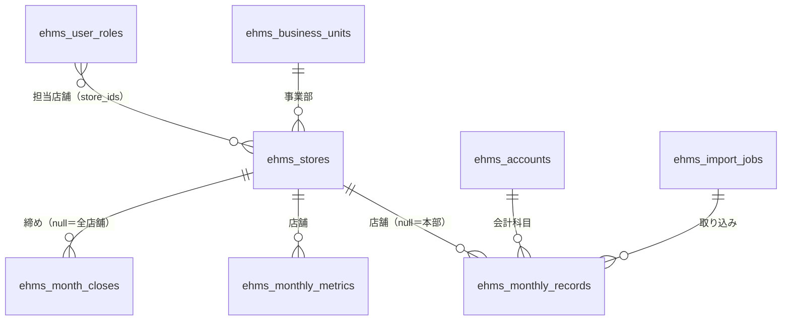

# EHMS データベース設計（Phase 1）

マイグレーション：`sql/2026-11-25_ehms_phase1.sql`（既存テーブルは変更しない。名前はすべて `ehms_`）

| テーブル | 主な列 | 説明 |
|---|---|---|
| `ehms_business_units` | id, name, active, sort | 事業部。無効化できる（削除しない） |
| `ehms_stores` | id, code（一意）, name, business_unit_id, active, opened_on, closed_on, sort | 店舗。閉店は closed_on と active=false |
| `ehms_accounts` | id, code（一意）, name, section, is_labor, is_fixed, hq_only, active, sort | 会計科目。section：revenue / cogs / sga / non_op_income / non_op_expense / extra_gain / extra_loss / tax |
| `ehms_settings` | key, value(jsonb) | company（会社名・会計年度の開始月）、targets（目標値）、allocation（本部経費の配賦方式）、forecast（着地予測の方式） |
| `ehms_monthly_records` | id, store_id（null＝本部）, month（月初日）, account_id, kind（actual / budget / forecast）, scenario（初期 base）, amount（整数円）, source（manual / import / sheet / system）, import_job_id, note, version, created_*/updated_* | 月次の金額。**自然キー（店舗・月・科目・区分・シナリオ）で一意** → 同じ取り込みを繰り返しても重複しない |
| `ehms_monthly_metrics` | store_id, month, metric, kind, scenario, value | 金額以外の月次指標（新患数・延べ来院数・常勤換算など）。同じく自然キーで一意 |
| `ehms_month_closes` | store_id（null＝全店舗）, month, closed_at, closed_by | 月次締め |
| `ehms_import_jobs` | file_name, file_hash, target, rows_total/inserted/updated/skipped, errors(jsonb) | 取り込みの履歴 |
| `ehms_audit_logs` | table_name, record_id, action, before, after, actor, at | 変更履歴（トリガーで自動） |
| `ehms_user_roles` | auth_uid, name, role, store_ids, active | EHMS の役割と担当店舗 |

## 関数・トリガー
- `ehms_role()`：ログイン中の人の役割。`ehms_user_roles` になければ、`clinic_staff` で admin かつ salary_viewer の人だけ owner。
- `ehms_store_ids()`、`ehms_can_read_store(store_id)`、`ehms_can_write_store(store_id)`：店舗単位の読み書き可否（RLS で使う）。
- `ehms_month_closed(store_id, month)`：その月が締め済みか。
- トリガー：`*_audit`（全テーブルの変更履歴）、`*_touch`（updated_at と version を更新）、`*_closed`（締めた月の実績の追加・変更・削除を拒否）。

## データの区別
- 実績・予算・予測は `kind` で分ける。シミュレーションは `scenario` を分ける（base 以外）。確定実績・承認済み予算は書き換えない。
- 未入力は行がない状態（＝ null）。ゼロは amount=0 の行。画面と計算で区別する。
- サンプル（デモ）データはデータベースに保存しない。

## 初期データ
事業部1（整骨院事業）・店舗7・会計科目50（売上16・原価5・販管費24・営業外2・特別2・法人税等1）・設定4。金額のサンプルは入れていない。
